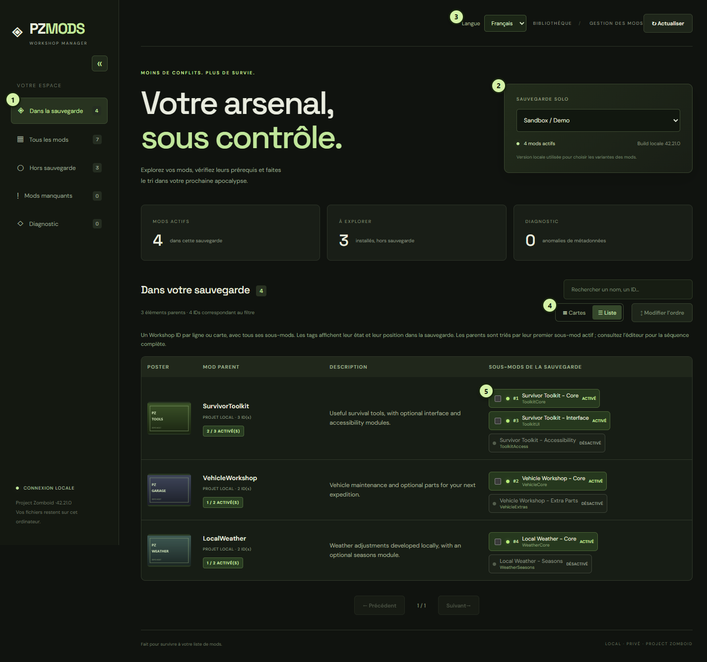
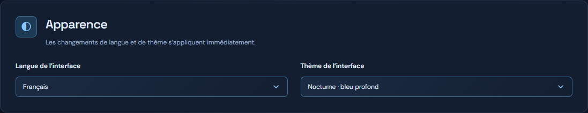
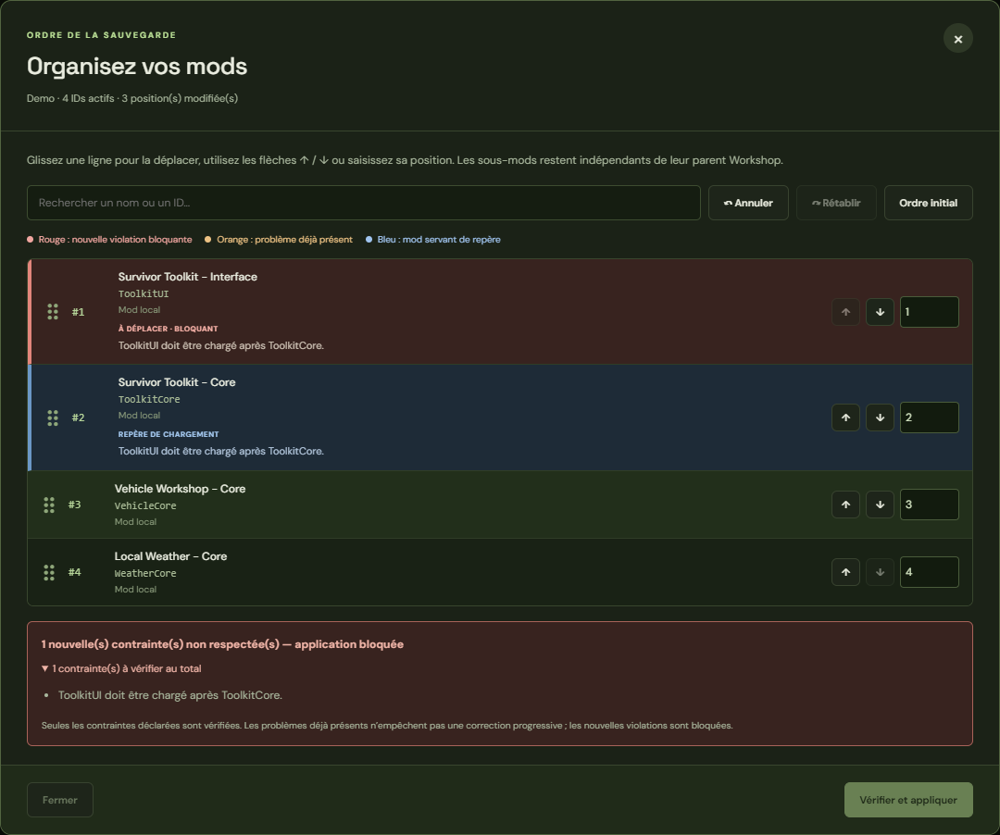
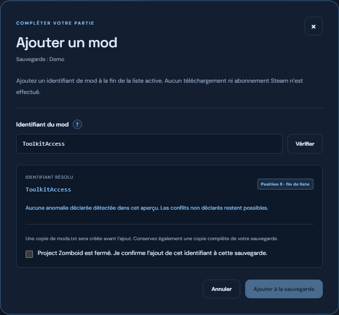
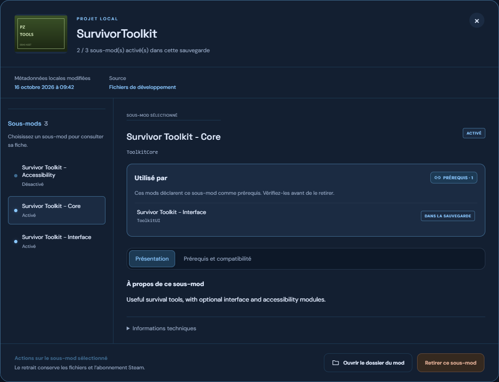

<div align="center">

# PZ Mods

**Votre arsenal, sous contrôle.**

Un gestionnaire local pour explorer, diagnostiquer et organiser les mods de vos sauvegardes solo de **Project Zomboid**.


[Démarrer](#démarrage-rapide) · [Fonctionnalités](#fonctionnalités) · [Tri](#trier-la-bibliothèque) · [Import / export](#importer-exporter-et-créer-une-collection) · [Ordre des mods](#réorganiser-une-sauvegarde) · [Développement](#développement) · [Confidentialité](#confidentialité)

</div>



_Capture réelle de l’application, avec des mods et une sauvegarde de démonstration fictifs._

| Repère | Fonctionnalité                                                                             |
| ------ | ------------------------------------------------------------------------------------------ |
| **1**  | Filtrer les mods actifs, installés, hors sauvegarde ou manquants ; ouvrir le diagnostic    |
| **2**  | Choisir une sauvegarde solo et consulter sa version locale de référence                    |
| **3**  | Ouvrir la configuration : langue, thèmes et dossiers analysés                              |
| **4**  | Basculer entre cartes et tableau ; ouvrir l’éditeur d’ordre                                |
| **5**  | Voir un seul parent avec ses sous-mods activés/désactivés et leurs positions de chargement |

> Un élément Workshop peut contenir plusieurs sous-mods. PZ Mods distingue **le parent Steam**, **les IDs Zomboid** et **les projets locaux** pour que chaque action ait une portée claire.

## Fonctionnalités

| Explorer                                                     | Comprendre                                                | Organiser                                            |
| ------------------------------------------------------------ | --------------------------------------------------------- | ---------------------------------------------------- |
| Vues **cartes** et **tableau**, avec posters et descriptions | Prérequis actifs, inactifs ou manquants                   | Éditeur d’ordre par **glisser-déposer**              |
| Parents Workshop regroupés, tags par sous-mod                | Incompatibilités déclarées et doublons d’IDs              | Flèches ↑ / ↓ et déplacement à une position précise  |
| Recherche avec effacement rapide et filtres                  | Plages de versions et variantes Build 42                  | Annuler, rétablir et restaurer l’ordre initial       |
| Mods Steam **et** projets de développement locaux            | Date de mise à jour Steam et date des métadonnées locales | Prévisualisation et copie de sécurité avant écriture |
| Tri par nom, mise à jour ou ordre de sauvegarde              | Aperçu des associations sous-mods / parents Workshop      | Export serveur `.ini` et manifeste `.json`           |
| Pagination et préférences mémorisées                         | Analyse d’une liste serveur, avec alertes de résolution   | Abonnements Steam et création guidée de collections  |

L’application permet aussi **d’ajouter un modId à la sauvegarde courante**, avec aperçu et copie de sécurité, et d’identifier les mods qui utilisent un autre mod comme **prérequis**.

Les filtres distinguent les mods **dans la sauvegarde**, **hors sauvegarde**, **manquants** et ceux à examiner dans le **diagnostic**. Le choix cartes/liste est mémorisé dans le navigateur.

Le sélecteur **Éléments par page** propose 12, 24, 36, 60 ou 100 parents par page, en cartes comme en tableau. Ce choix est conservé entre les pages, filtres et sauvegardes, ainsi qu’au rafraîchissement. Un changement de taille revient à la première page et ne sépare jamais les sous-mods d’un même parent.

La navigation latérale peut se replier en colonne d’icônes sur ordinateur. Les intitulés restent accessibles au survol et au clavier ; ce choix est également conservé au rafraîchissement.

### Trier la bibliothèque

Le sélecteur **Trier par** fonctionne en cartes comme en tableau :

| Tri                               | Comportement                                                                                                    |
| --------------------------------- | --------------------------------------------------------------------------------------------------------------- |
| **Ordre de la sauvegarde**        | Disponible dans « Dans la sauvegarde » ; chaque parent se place à la première position de ses sous-mods actifs. |
| **Mise à jour : plus récentes**   | Date décroissante.                                                                                              |
| **Mise à jour : plus anciennes**  | Date croissante.                                                                                                |
| **Nom : A → Z** / **Nom : Z → A** | Tri sur le nom affiché du parent, avec prise en compte des accents et des nombres.                              |

Le tri s’applique à toute la liste filtrée **avant pagination**, conserve les sous-mods regroupés et revient à la première page lors d’un changement. Le choix est mémorisé à la navigation et au rafraîchissement. Hors de la vue de sauvegarde, le choix « ordre de la sauvegarde » utilise temporairement le tri A à Z.

Les dates proviennent de Steam pour les parents Workshop et de la dernière modification de `mod.info` pour les projets locaux. Pour un projet local contenant plusieurs sous-mods, la date la plus récente est retenue. Les dates inconnues restent à la fin dans les deux sens. Les métadonnées Steam de toute la bibliothèque sont chargées pour permettre un tri global ; le classement se précise à leur réception. **Trier l’affichage ne modifie jamais l’ordre enregistré dans la sauvegarde.**

### Français et anglais

Dans **Configuration → Apparence**, le sélecteur de langue permet de passer du **français** à l’**anglais** sans recharger la page. Le choix est conservé au rafraîchissement et à la prochaine ouverture dans le même navigateur. À la première visite, la langue du navigateur détermine la langue proposée.

Les dates, boutons, messages de diagnostic et contrôles d’ordre sont traduits. Les noms, IDs et descriptions fournis par les créateurs de mods restent dans leur langue d’origine. Les traductions de l’interface se trouvent dans `web/locales/`.

### Une interface personnalisable

**Configuration → Apparence** propose quatre thèmes : **Survivant** (vert), **Nocturne** (bleu), **Améthyste** (violet) et **Cuivre**. Le changement est immédiat et le thème reste actif à la navigation et au rafraîchissement.



Les menus déroulants et infobulles utilisent des composants React Radix personnalisés : navigation au clavier, sélection visible, fermeture avec Échap et animations d’ouverture. Les panneaux, onglets et boutons partagent les couleurs du thème et des transitions discrètes. Le réglage système **réduire les animations** est respecté.

### Retrouver sa navigation

La page ouverte (bibliothèque ou configuration), la sauvegarde sélectionnée, la vue de bibliothèque, la recherche et le numéro de page sont mémorisés. Chaque vue retrouve sa propre recherche et sa page **pour chaque sauvegarde**. Le mode cartes/tableau, le tri, le nombre d’éléments par page, la langue, le thème et le repli de la barre latérale sont également conservés.

Ces préférences restent dans le stockage local du navigateur, pour la même adresse et le même port. Si une sauvegarde a disparu, l’application revient à une sauvegarde disponible ; si une page n’existe plus après actualisation, elle revient à la dernière page valide. Les confirmations d’actions et les brouillons de modification ne sont pas réexécutés au rechargement.

## Démarrage rapide

### Prérequis

- **Windows**, avec Project Zomboid installé via Steam.
- **Node.js 24 ou plus récent**, avec npm.
- Une sauvegarde **solo** contenant `mods.txt`.

Aucune clé API Steam n’est nécessaire.

```powershell
git clone https://github.com/cyberbobjr/pz-mods.git
cd pz-mods
npm ci
npm run build
npm start
```

Ouvrir **[http://localhost:4273](http://localhost:4273)**.

Le backend sert directement l’interface compilée. Garder le terminal ouvert ; **Ctrl+C** arrête le serveur. L’adresse `http://127.0.0.1:4273` fonctionne également.

**Sous Windows :** double-cliquer sur [`lancer.bat`](lancer.bat) pour installer les dépendances si nécessaire, compiler l’interface et ouvrir le navigateur.

## Une interface, deux niveaux

### Le parent Workshop

Il correspond à **un abonnement Steam**, avec un titre, une description, un poster et un identifiant Workshop. Une ligne ou carte présente tous les sous-mods installés de ce parent.

### Les sous-mods Zomboid

Chaque sous-mod possède son **propre ID** et son état dans la sauvegarde : **activé** ou **désactivé**. Cliquer sur son tag ouvre sa fiche, ses prérequis et ses incompatibilités.

Dans sa fiche, **Ouvrir le dossier du mod** ouvre l’Explorateur Windows sur le répertoire du sous-mod sélectionné, pour les mods Steam comme pour les mods locaux. Il s’agit de la racine du mod, au-dessus des variantes `42` ou `common`. Le bouton est désactivé si les fichiers n’ont pas été détectés ; si le dossier a disparu depuis l’analyse, actualiser la bibliothèque. Le backend accepte uniquement un identifiant opaque associé à un dossier détecté, jamais un chemin libre fourni par le navigateur.

- **Retirer un sous-mod** modifie uniquement sa présence dans `mods.txt`.
- **Se désabonner sur Steam** concerne tout le parent et peut affecter d’autres sauvegardes.
- Le bouton **Abonnement du parent** ouvre actuellement la fiche Steam : le désabonnement direct depuis l’application n’est pas implémenté.

### Les mods locaux

Les emplacements suivants sont analysés sans les assimiler à des abonnements Steam :

```text
Zomboid/
├── mods/<mod>/
└── Workshop/<projet>/Contents/mods/<mod>/
```

Les liens vers des dossiers de développement sont pris en charge à l’entrée de `mods/`. Les variantes de version et les métadonnées `mod.info` servent à afficher nom, description et image. Pour les projets Workshop locaux, `preview.png` sert de remplacement si aucun poster de mod n’est disponible.

Les sources locales restent sur le disque quand un ID est retiré de la sauvegarde. Leur présence sur disque ne prouve pas à elle seule que le jeu charge ce projet ; les doublons d’IDs sont signalés.

## Réorganiser une sauvegarde

1. Choisir une sauvegarde puis ouvrir **Dans la sauvegarde → Modifier l’ordre**.
2. Déplacer une ligne, utiliser **↑ / ↓**, ou saisir une position et valider avec **Entrée**.
3. Examiner les contraintes signalées. La recherche conserve les positions de la liste complète.
4. Cliquer sur **Vérifier et appliquer** pour revoir les changements.
5. **Fermer Project Zomboid**, puis confirmer l’enregistrement.

### Un code couleur explicite



_Exemple fictif : « Interface » a été placé avant « Core ». La ligne rouge explique le problème, la ligne bleue identifie le prérequis et l’application du brouillon est bloquée._

| Couleur   | Signification                                                                |
| --------- | ---------------------------------------------------------------------------- |
| 🔴 Rouge  | Nouvelle violation d’une contrainte déclarée : application bloquée           |
| 🟠 Orange | Problème déjà présent dans l’ordre initial : correction progressive possible |
| 🔵 Bleu   | Mod servant de repère dans une contrainte de chargement                      |

Les badges et explications accompagnent les couleurs. Le contrôle utilise les prérequis et les directives `loadModAfter` / `loadModBefore` lorsque les deux mods sont actifs.

L’éditeur conserve **exactement les mêmes IDs**, y compris leurs préfixes Workshop. Les cartes, commentaires et fins de ligne restent en place. Il ne retire aucun mod et ne change aucun abonnement Steam.

**Voir l’ordre sans le modifier :** les tags affichent leur position dans `mods.txt`. La bibliothèque conserve toujours **une seule ligne ou carte par Workshop ID**, avec tous ses sous-mods à droite. Les parents sont triés par leur premier sous-mod actif. L’éditeur montre la séquence exacte des IDs sans enregistrer de changement tant que vous ne confirmez pas.

## Ajouter un mod à une sauvegarde

1. Sélectionner la sauvegarde puis cliquer sur **Ajouter un mod**, ou ouvrir la fiche d’un sous-mod inactif et cliquer sur **Activer dans la sauvegarde**.
2. Saisir le **modId déclaré dans `mod.info`**, par exemple `ExampleCore`. Un identifiant qualifié `123456789/ExampleCore` est accepté pour préciser un fournisseur Workshop.
3. Cliquer sur **Vérifier** : l’aperçu indique l’ID résolu, sa future position, les prérequis manquants, les incompatibilités et les contraintes de chargement à examiner.
4. Fermer Project Zomboid, confirmer puis cliquer sur **Ajouter à la sauvegarde**.

Le mod est ajouté **en fin de liste**, sans modifier les lignes existantes. Les prérequis ne sont pas ajoutés automatiquement : consulter les avertissements puis utiliser l’éditeur d’ordre si nécessaire. Aucun abonnement Steam ni téléchargement n’est lancé par cette action. Un ID inconnu peut être enregistré après avertissement, mais ses fichiers devront être installés pour jouer. Un mod déjà actif n’est pas ajouté une seconde fois.



Comme les autres écritures, l’ajout contrôle la révision de `mods.txt`, crée une copie de sécurité et refuse d’écrire si le jeu est ouvert ou si le format du fichier est ambigu.

## Identifier les mods qui dépendent d’un prérequis

Le badge **PRÉREQUIS · N** apparaît sur les parents concernés, en cartes comme en tableau. Son infobulle indique combien de mods déclarent un sous-mod de ce parent comme prérequis et combien sont actifs dans la sauvegarde courante. Cliquer sur le badge ouvre la fiche du sous-mod concerné.

La section **Utilisé par** liste les consommateurs directs du sous-mod, avec leurs IDs et leur état **dans la sauvegarde** ou **installé, inactif**. Cliquer sur un consommateur ouvre sa fiche. Les variantes d’un même fournisseur sont dédupliquées ; les dépendances entre sous-mods d’un même parent sont incluses. Ces informations reflètent les déclarations des mods, sans déduire les dépendances non déclarées.



## Importer, exporter et créer une collection

Le bouton **Importer / exporter** ouvre un aperçu avant toute action :

- **Depuis une sauvegarde** : télécharger un fragment serveur `.ini` ou un manifeste JSON. `Mods=` conserve l’ordre des IDs Zomboid ; `WorkshopItems=` contient les parents Steam sans doublons.
- **Depuis un serveur** : coller une liste ou charger un `.ini`, puis analyser. Seules les directives `Mods=` et `WorkshopItems=` sont retenues ; les mots de passe et autres paramètres sont ignorés.
- **Abonnements** : connecter Steam, examiner les parents proposés, puis confirmer. Les éléments déjà abonnés sont conservés et les échecs sont détaillés par lot.
- **Collection** : ouvrir le formulaire officiel Steam prérempli, terminer sa création dans le navigateur, puis revenir détecter la collection et confirmer l’ajout des parents sélectionnés.

Microsoft Edge ou Google Chrome doit être installé pour ces actions Steam. La connexion s’effectue dans une fenêtre dédiée, avec son propre profil local `.cache/steam-profile/`. Aucun mot de passe ni cookie n’est transmis à l’interface de PZ Mods et aucune clé API n’est nécessaire. La création du formulaire reste une étape manuelle sur Steam ; l’application ne publie pas automatiquement une collection.

Les mods locaux ne peuvent pas devenir des abonnements Workshop. Les IDs introuvables, ambigus ou absents de `WorkshopItems=` sont signalés. Une liste importée ne modifie aucune sauvegarde. Le fragment exporté ne remplace pas une configuration serveur complète : configurer séparément les cartes (`Map=`), les paramètres du monde et les mods locaux nécessaires. Une collection Steam ne conserve ni les sous-mods activés ni leur ordre : conserver aussi le fragment serveur ou le manifeste.

### Exemple de transfert serveur

```ini
Mods=ExampleCore;ExampleVehicles;ExampleOptionalUI
WorkshopItems=1234567890;2345678901
```

Exemple fictif : trois sous-mods peuvent dépendre de deux parents Workshop. Les deux listes ne se correspondent pas par position. Le manifeste JSON conserve les associations connues, les IDs d’origine et les avertissements.

Pour reprendre cette liste : ouvrir **Importer / exporter → Importer un serveur**, coller les lignes ou charger le fichier, puis cliquer sur **Analyser le contenu**. Vérifier l’aperçu avant de télécharger les exports, de lancer les abonnements ou de créer une collection. Les opérations Steam sont exécutées par lots de dix, avec un bilan des réussites, abonnements déjà actifs et échecs. Les ajouts à une collection sont confirmés par relecture de son contenu.

## Sauvegardes et restauration

Avant une écriture, le backend vérifie que le jeu est fermé et que `mods.txt` n’a pas changé depuis l’analyse. Il crée ensuite une copie à côté du fichier :

```text
mods.txt.pz-mods-<date>-<identifiant>.bak
```

Pour restaurer : fermer le jeu et l’application, conserver une copie du fichier actuel, puis recopier le `.bak` choisi sous le nom `mods.txt`.

> **Avant de retirer des mods, conserver aussi une copie complète du dossier de sauvegarde.** Restaurer `mods.txt` ne restaure pas un monde déjà modifié par le jeu, notamment après le retrait de cartes, véhicules ou objets.

## Diagnostic : ce que l’application vérifie

- Les IDs de la sauvegarde sont présents dans les emplacements analysés.
- Les prérequis déclarés sont installés et activés.
- Les incompatibilités déclarées concernent des mods actifs.
- Les plages de versions détectées et les doublons d’IDs nécessitent un examen.
- Le brouillon d’ordre n’ajoute pas de nouvelles violations aux contraintes déclarées.

**L’absence d’alerte ne garantit pas l’absence de conflit en jeu.** L’analyse ne simule pas le moteur et ne détecte pas tous les conflits de scripts Lua, objets, cartes ou contenus non déclarés.

La version **locale du jeu** sert à choisir les variantes de mods ; ce n’est pas une reconstitution certaine de la version historique d’une sauvegarde. L’ordre affiché reflète `mods.txt`, pas une trace d’exécution réelle du moteur.

## Cache et utilisation hors connexion

| Informations                        | Stockage               | Durée avant actualisation |
| ----------------------------------- | ---------------------- | ------------------------- |
| Titres, descriptions et dates Steam | `.cache/workshop.json` | 6 heures                  |
| Posters Steam                       | `.cache/posters/`      | 7 jours                   |
| Posters servis au navigateur        | Cache navigateur       | 1 heure                   |
| Inventaire local                    | Mémoire du backend     | 30 secondes               |

Les données déjà téléchargées restent utilisables si Steam est indisponible, même après expiration. Une première connexion est nécessaire pour les éléments jamais consultés. Les téléchargements simultanés d’un même poster sont regroupés.

Le bouton **Actualiser** force une nouvelle lecture des sauvegardes et des fichiers de mods, même pendant les 30 secondes de cache. Les titres et posters Steam conservent leur cache séparé.

Après un désabonnement, Steam peut conserver temporairement les fichiers sur le disque. PZ Mods affiche leur présence réelle, sans en déduire que l’abonnement est encore actif. Une fois les fichiers retirés, un mod encore référencé dans la sauvegarde reste visible avec le badge **FICHIERS MANQUANTS** et l’état **MANQUANT** sur son sous-mod. Le désabonnement ne retire pas automatiquement son ID de `mods.txt`.

Pour vider les métadonnées et posters : arrêter le backend, supprimer `.cache/workshop.json` et `.cache/posters/`, puis relancer. Le profil de connexion Steam est séparé dans `.cache/steam-profile/` ; le supprimer déconnecte ce navigateur dédié. Les sauvegardes et sources de mods restent dans leurs emplacements d’origine.

## Configuration

Les emplacements par défaut sont `%USERPROFILE%\Zomboid` et les bibliothèques déclarées dans le `libraryfolders.vdf` de Steam.

La page **Configuration → Dossiers du jeu** permet de personnaliser :

| Réglage                    | Dossier attendu                                                                           |
| -------------------------- | ----------------------------------------------------------------------------------------- |
| Racine utilisateur Zomboid | Dossier principal des données utilisateur du jeu.                                         |
| Installation Steam         | Racine du client Steam, contenant `steamapps/libraryfolders.vdf`.                         |
| Sauvegardes solo           | Dossier `Saves`, contenant les modes puis leurs sauvegardes.                              |
| Mods locaux                | Un ou plusieurs dossiers contenant les répertoires des mods, un chemin par ligne.         |
| Workshop Project Zomboid   | Un ou plusieurs dossiers `steamapps/workshop/content/108600`, contenant les IDs Workshop. |

Les projets en développement sont toujours analysés dans `<racine Zomboid>/Workshop/<projet>/Contents/mods`. Les dossiers effectivement utilisés sont consultables sur cette page. Laisser un champ vide rétablit la détection automatique pour ce réglage ; **Restaurer la détection automatique** rétablit tous les chemins par défaut.

Cliquer sur **Enregistrer les dossiers** pour appliquer les chemins : seuls des dossiers absolus existants sont acceptés, l’inventaire est rechargé sans redémarrage et aucun fichier de jeu n’est déplacé. Les réglages sont enregistrés dans `.cache/settings.json`, exclu de Git, et repris au prochain lancement. Ils sont communs aux navigateurs utilisant ce backend. Les préférences d’apparence et de navigation restent propres au navigateur.

Les variables d’environnement restent disponibles comme valeurs par défaut, lorsqu’aucun chemin n’est configuré dans l’interface :

```powershell
$env:PZ_USER_DIR = Join-Path $env:USERPROFILE 'Zomboid'
$env:STEAM_PATH = 'D:\Steam'
$env:PORT = '4273'
npm start
```

Ces variables sont facultatives. Aucun fichier `.env` n’est nécessaire ni chargé automatiquement. En développement, adapter aussi le proxy de `vite.config.ts` si le port du backend change.

Si un dossier configuré n’est plus accessible au démarrage, l’application revient aux chemins automatiques. Vérifier et réenregistrer les réglages après avoir reconnecté un disque externe.

## Développement

Installer d’abord les dépendances avec `npm ci`, puis ouvrir **deux terminaux** dans le projet.

| Terminal              | Commande               | Adresse                 |
| --------------------- | ---------------------- | ----------------------- |
| Backend Fastify       | `npm run dev:backend`  | `http://127.0.0.1:4273` |
| Frontend React / Vite | `npm run dev:frontend` | `http://127.0.0.1:5173` |

Le frontend relaie `/api` vers le backend. Utiliser les adresses indiquées ; les deux services doivent rester ouverts. Le backend et Vite rechargent leurs sources après modification.

### Vérifications

```powershell
npm run check         # UTF-8, ESLint, types, tests et build
npm run format:check  # Mise en forme Prettier
npm run format        # Appliquer Prettier
```

Les tests utilisent des fichiers temporaires et des réponses Steam simulées ; ils n’écrivent pas dans les sauvegardes réelles.

Le frontend utilise des composants Radix comportant la directive React Server Components `"use client"`. L’application étant entièrement rendue dans le navigateur, le build ignore uniquement l’avertissement Rollup `MODULE_LEVEL_DIRECTIVE` correspondant à cette directive dans les paquets `@radix-ui`. Les autres avertissements restent visibles.

### Architecture

```text
src/
├── domain/        Modèles et règles métier indépendants
├── application/   Cas d’usage et ports
└── adapters/      Fichiers Zomboid, Steam, cache et serveur HTTP
web/               Interface React
test/              Tests métier et adaptateurs
```

L’architecture hexagonale et les dépendances autorisées sont documentées dans [`AGENTS.md`](AGENTS.md). Le domaine ne dépend ni du disque, ni de Fastify, ni de Steam.

## Confidentialité

- Le serveur écoute uniquement sur **l’interface locale** et contrôle l’origine des mutations.
- Aucune clé Steam, session Steam ou connexion au compte n’est nécessaire pour consulter les informations publiques.
- Les sauvegardes, caches, dépendances et fichiers d’environnement sont exclus de Git.
- Le profil Steam dédié contient des données de connexion locales : ne jamais partager `.cache/steam-profile/`. Les actions d’abonnement et de collection nécessitent une connexion Steam et une confirmation explicite dans l’application.
- Les métadonnées Steam et posters sont récupérés par le backend ; les polices Google Fonts peuvent être chargées par le navigateur.
- Les chemins de fichiers locaux sont visibles dans votre interface et peuvent apparaître dans vos captures : les vérifier avant de les partager.

Le dépôt contient le code, la documentation et des données de test fictives, sans export de sauvegarde ni inventaire personnel de mods.

---

<div align="center">

**Moins de conflits. Plus de survie.**

Projet communautaire indépendant, sans affiliation avec The Indie Stone ou Valve.

</div>
