<div align="center">

# PZ Mods

**v1.0.0** · [Changelog](CHANGELOG.md) · [Français](README_fr.md)

**Your loadout, under control.**

A local mod manager for Project Zomboid players: understand what your save uses, prepare a mod collection and review changes before writing them.

</div>

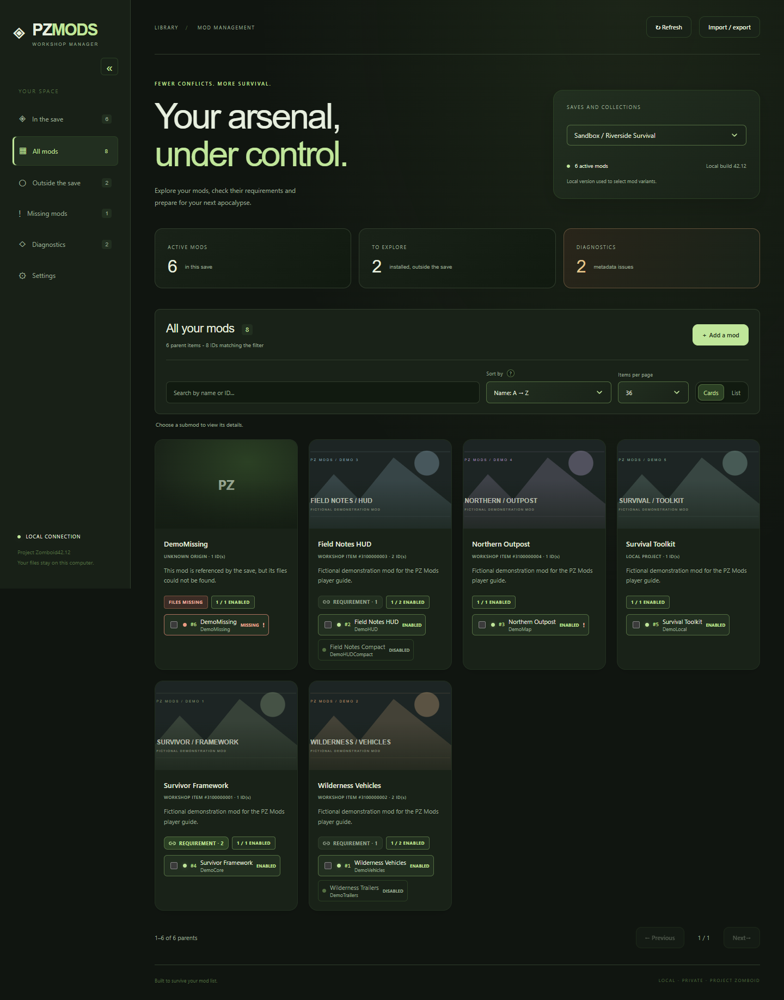

All screenshots show the real application in English, using fictional mods, saves and collections. Posters and Steam account responses are demonstration data; no real account actions were performed. Mod names and descriptions supplied by their authors are not translated by the application.

[Get started](#start-playing-with-an-organized-mod-list) · [Browse](#2-browse-workshop-parents-and-individual-submods) · [Diagnostics](#4-understand-diagnostics-before-changing-your-game) · [Auto-sort](#9-sort-automatically-by-prerequisites-and-loading-constraints) · [Collections](#11-maintain-a-reusable-local-collection) · [Transfers](#13-export-a-server-list-or-a-manifest) · [Settings](#17-choose-your-language-theme-and-navigation-layout)

## Start playing with an organized mod list

Requires **Windows**, **Project Zomboid installed through Steam**, and **Node.js 24+** with npm. You can use a single-player save containing `mods.txt` or a local collection saved in `Lua/pz_modlist_settings.cfg`. No Steam API key is required.

```powershell
git clone https://github.com/cyberbobjr/pz-mods.git
cd pz-mods
npm ci
npm run build
npm start
```

Open **http://localhost:4273** or **http://127.0.0.1:4273**. Keep the terminal open; Ctrl+C stops the server. On Windows, double-click [`lancer.bat`](lancer.bat) to install dependencies when needed, build the interface and open your browser.

Choose your save or collection, inspect **Diagnostics**, then review any additions, removals or order changes. Close Project Zomboid before saving changes.

## 1. Choose a save or local collection

The **Saves and collections** menu separates single-player saves from native local collections. Select a source to see its active IDs, missing files and diagnostics. A save's local build helps choose installed mod variants; it is not proof of the build originally used by that save.

Local collections come from `<userDir>/Lua/pz_modlist_settings.cfg`; favorites are excluded. Editing a collection does not edit a save. The game may recalculate the order when you activate a collection.

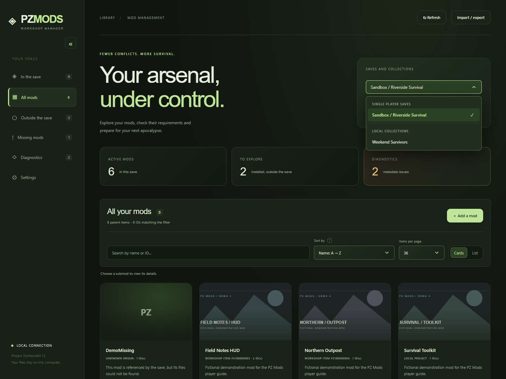

## 2. Browse Workshop parents and individual submods

Use **All mods** to browse installed content, **In the save** for active references and **Outside the save** for installed but inactive mods. Steam Workshop items and local development projects appear in the same library.

A Workshop parent represents one Steam item, which may provide several Zomboid submods. Each submod tag shows its own ID, enabled/disabled state and saved load position. Click the title, poster or a tag to open details. Disabling a reference and unsubscribing from its Workshop parent have different scopes.


## 3. Find mods quickly and customize the list

Switch between **Cards** and **List**, search by name or ID, and clear the search in one click. Choose 12, 24, 36, 60 or 100 parents per page; submods of the same parent stay together.

**Sort by** offers name A–Z/Z–A, newest/oldest update, and saved order in the active view. Sorting applies to the entire filtered list before pagination. Workshop dates come from Steam; local dates come from metadata changes. Unknown dates stay last. Display sorting never rewrites the saved load order.

The browser remembers the source, page, search and filter context, along with layout, sort and page size. Each save or collection retains its own navigation context.

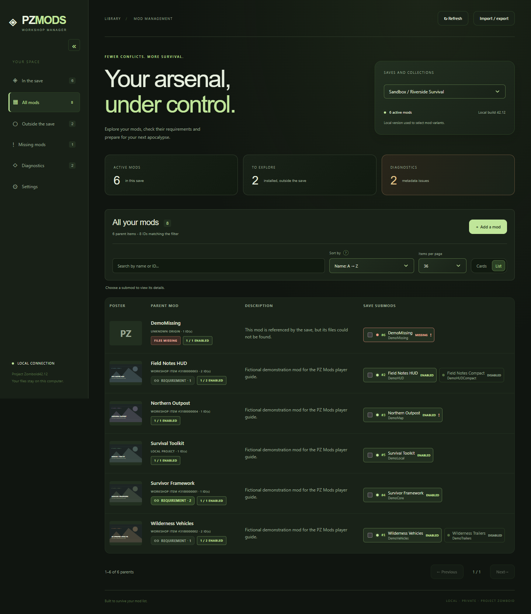

## 4. Understand diagnostics before changing your game

Open **Diagnostics** to inspect missing files, requirements that are absent or inactive, declared incompatibilities, duplicate IDs and version-range issues. Click an issue to inspect its mod. **Refresh** rescans local files, useful after Steam installs or removes content.

These checks read available metadata. They do not detect every Lua, map or content conflict, and no alerts cannot guarantee conflict-free gameplay. A backup of `mods.txt` also does not replace a full save backup before changing map, vehicle or item mods.

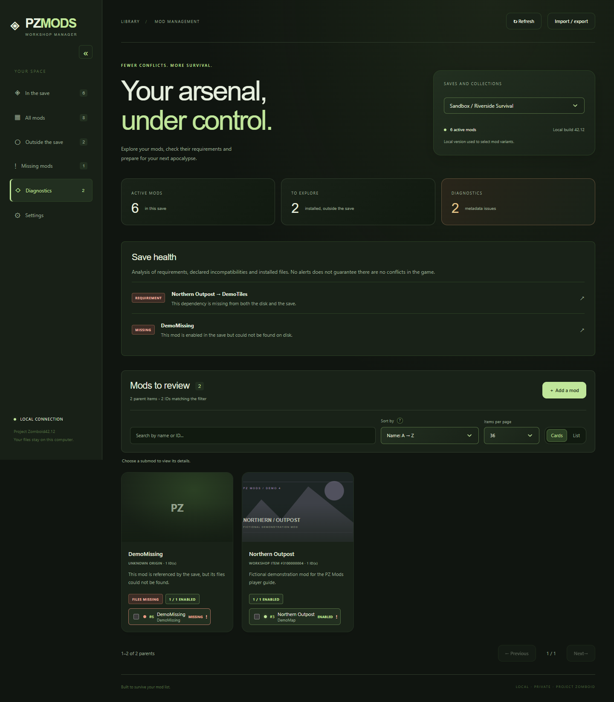

## 5. Read a mod's requirements and inspect its files

Open a submod and select **Requirements and compatibility**. Check its prerequisites, declared incompatibilities, version information and active status. The detail view also shows descriptions and Steam or local metadata dates.

**Open mod folder** opens the detected submod root in Windows Explorer, for Workshop and local mods. If files are missing, the action is unavailable; refresh the library if a folder disappeared after scanning.

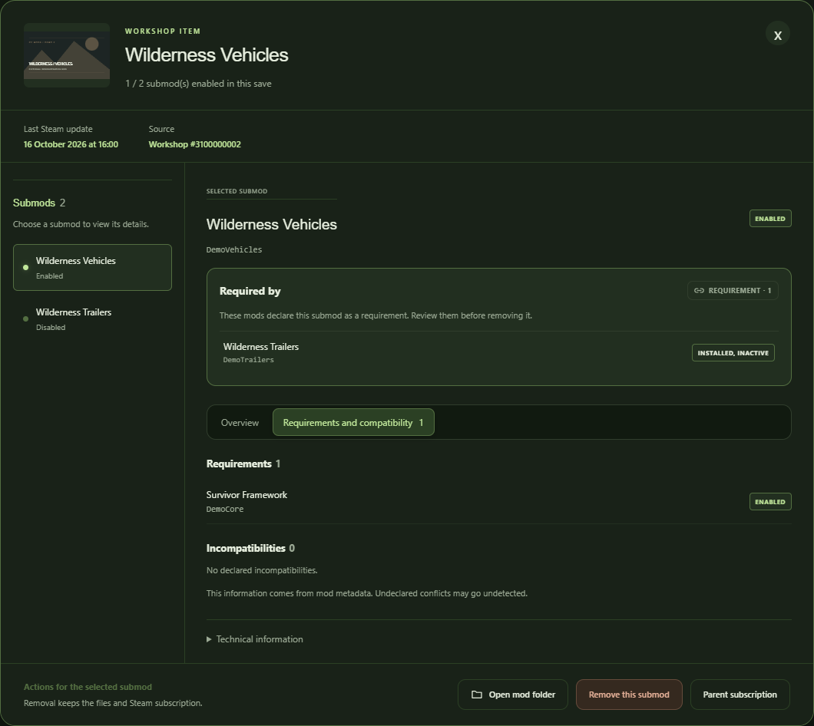

## 6. See which mods depend on a prerequisite

The **Requirement** badge on a parent shows how many mods declare one of its submods as a prerequisite. Click it to inspect the relevant submod. **Used by** lists direct consumers and distinguishes active mods from installed but inactive ones. Click a consumer to open its details.

This helps you assess a removal: installed prerequisites used by remaining active mods are protected. Undeclared dependencies cannot be inferred.

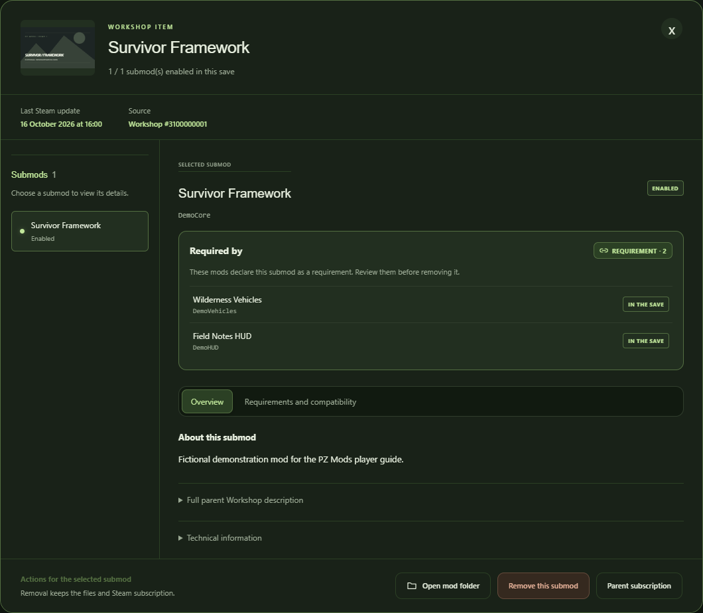

## 7. Add a mod ID to the selected source

Click **Add a mod**, enter the ID from `mod.info` (not the display name or Steam URL), then **Check**. A qualified ID such as `3100000002/DemoTrailers` selects a specific Workshop provider. Review the resolved ID, append position and warnings, confirm the game is closed, then add it.

The ID is appended. Requirements are not automatically enabled, files are not downloaded and no Steam subscription is created. An already active reference is not duplicated. Unknown IDs can be added after a warning, but their files must be installed before playing.

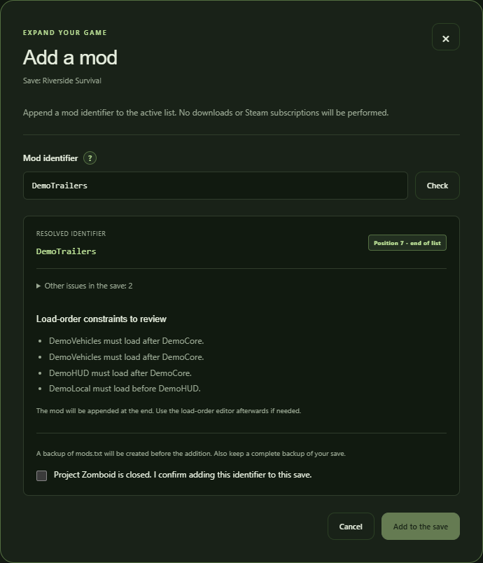

## 8. Reorder submods manually

From the active view, open **Edit load order**. Drag a row, use its ↑/↓ buttons, or type a position. Submods stay independent of their Workshop parent. Search narrows the displayed rows while positions remain those of the full list.

**Undo**, **Redo** and **Original order** let you revise the draft. Red marks newly introduced order violations, orange marks existing problems and blue identifies a referenced mod. New declared violations block saving; existing issues allow progressive correction.

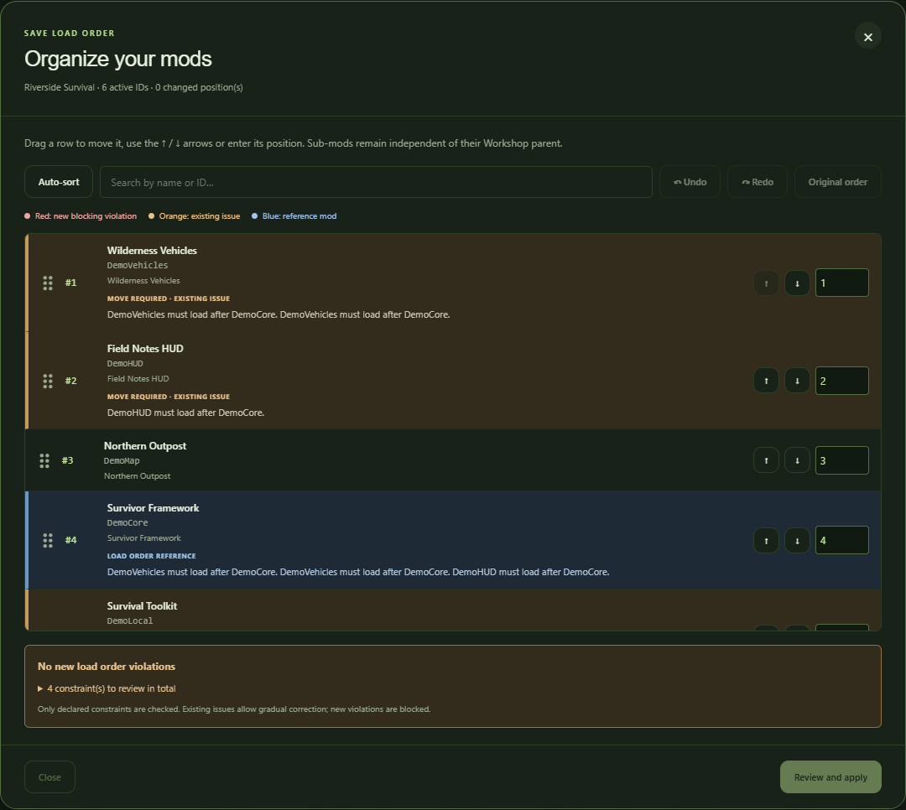

## 9. Sort automatically by prerequisites and loading constraints

Click **Auto-sort** inside the order editor. It arranges every active ID using declared `require`, `loadAfter` and `loadBefore` metadata, including rows hidden by a search. Requirements precede their consumers; current draft positions break ties between available choices.

The result is an undoable draft. No mod is added, removed, downloaded or unsubscribed, and exact IDs and Workshop qualifiers are preserved. A cycle leaves the draft unchanged and reports blocked IDs, including downstream dependents. Missing prerequisites remain diagnostic issues. Undeclared order constraints are not inferred.

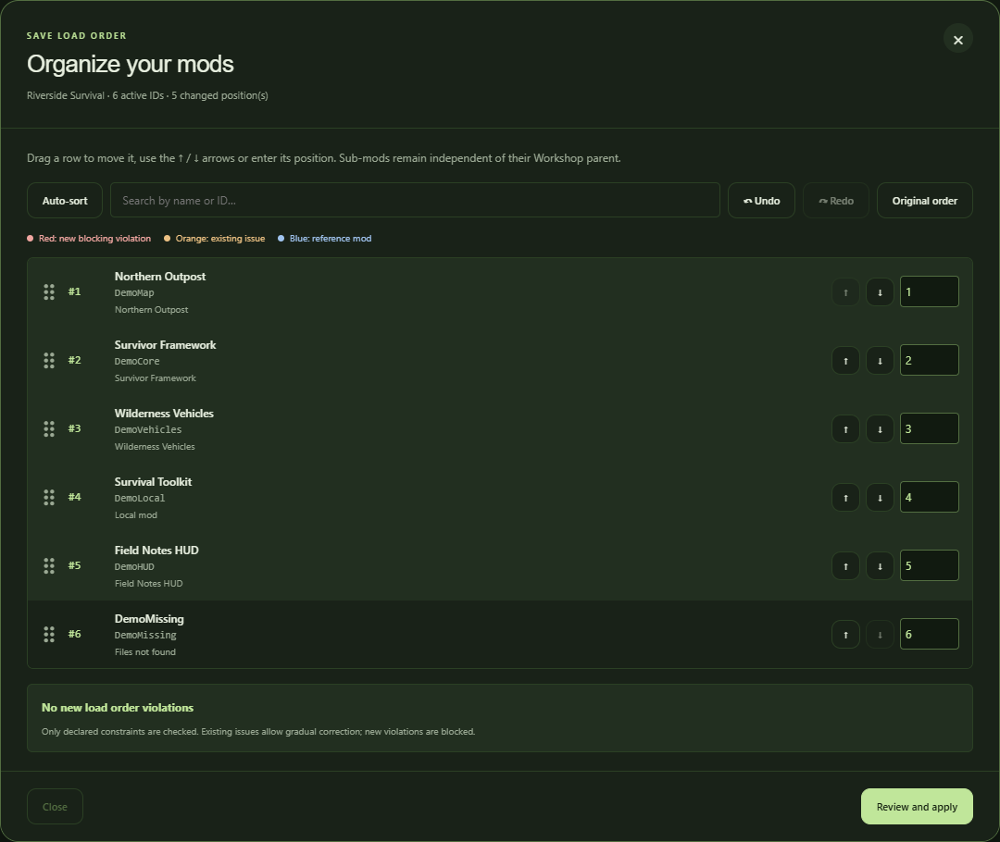

## 10. Review and save order changes with a backup

Select **Review and apply** to inspect changed positions before **Confirm and save**. Close Project Zomboid first. The application checks that the source has not changed, validates the proposed order and backs up the existing file before writing.

For collections, only the selected profile changes; other profiles and favorites remain intact. New profile backups are stored in `<userDir>/backups/pz-mods/profiles/`. The interface reports saving, success time or an error. An order saved in a collection is not a guarantee of the game's runtime order.

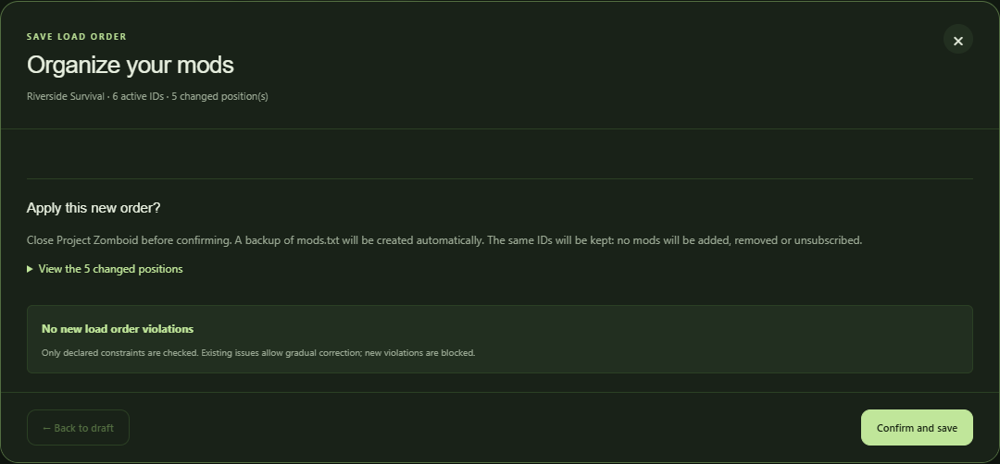

## 11. Maintain a reusable local collection

Select a local collection to use the same browsing, diagnostics, addition, removal and order tools as for saves. Collection edits affect the native profile file and preserve unrelated profiles, favorites, unknown lines, encoding and line endings.

Use the collection name controls to manage separate setups for different playthroughs. A collection has no associated save version, so version-dependent diagnostics have limits.

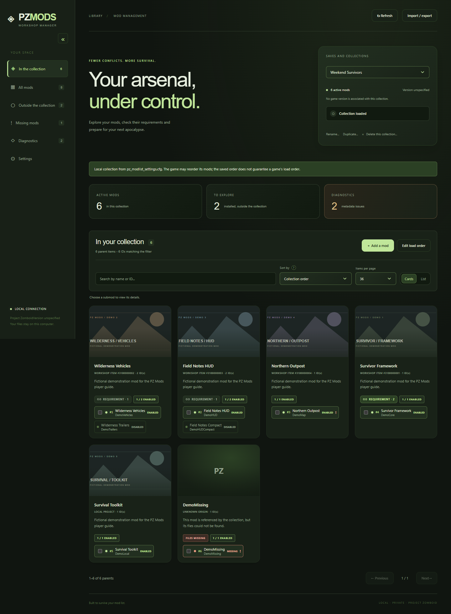

### Duplicate a collection

Click **Duplicate…**, choose an unused name and confirm the game is closed. The copy keeps the source's exact mod references and copies its browser navigation preferences. The original remains available.

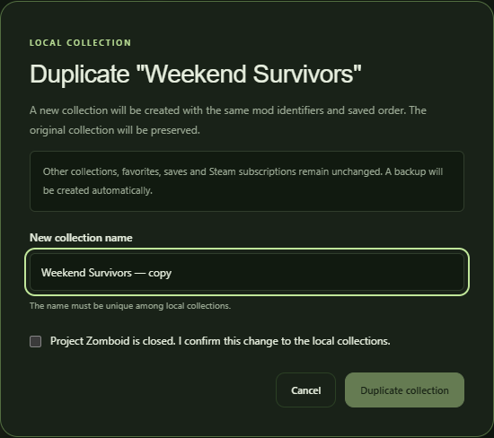

### Rename a collection

Click **Rename…** and enter an unused name. The collection keeps its mod references and its navigation preferences follow the new name. Existing collection names are rejected rather than overwritten.

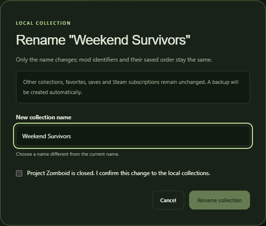

### Delete a collection

**Delete this collection…** requires explicit confirmation and the game to be closed. It removes only the selected native profile, with a backup, while preserving other collections and favorites. It does not delete installed mods or unsubscribe from Steam.

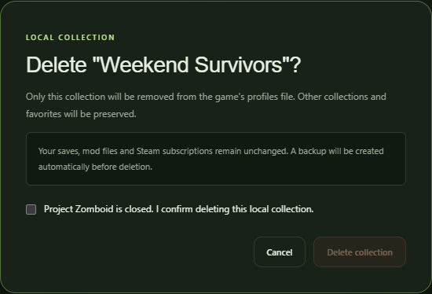

## 12. Clean missing references or remove selected submods

In **Missing mods**, click **Select missing mods** to select all matching references before pagination. Review the selection, then remove the IDs and confirm. For installed active mods, select individual submod checkboxes to remove only those references.

Removing an ID leaves files and Steam subscriptions intact. Qualified references such as `123/MyMod` and `456/MyMod` stay distinct. Removing a stale reference does not hide an unresolved dependency; installed requirements needed by remaining active mods stay protected. If another in-game manager reinserts references, correct that manager separately.

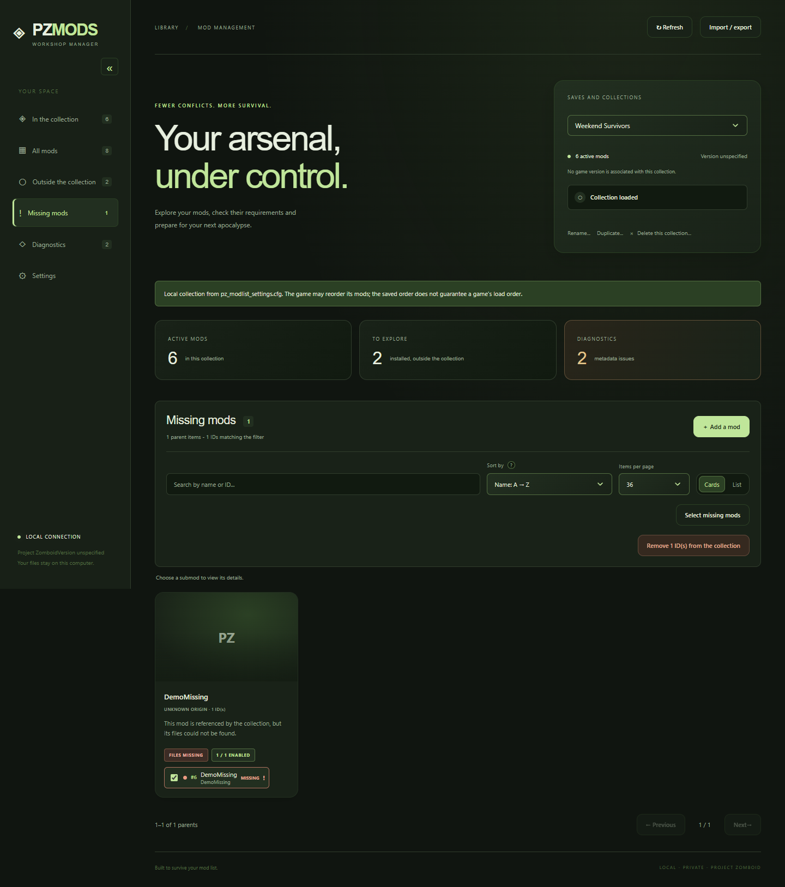

The confirmation identifies the selected source and reminds you what will change. Revision checks, game-closed guards and backups apply to removals too.

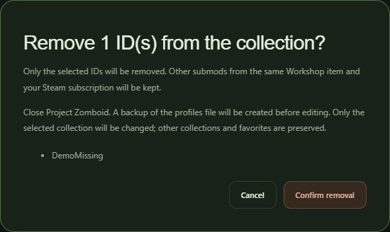

## 13. Export a server list or a manifest

Open **Import / export** from a save or collection. Review the server fragment, mod-to-Workshop associations and warnings, then copy the configuration or download `.ini` and `.json` exports.

`Mods=` preserves the Zomboid ID sequence; `WorkshopItems=` lists Steam parents without duplicates. These lists do not correspond by position. Local, missing and ambiguous mods are flagged. The fragment is not a complete server configuration: configure `Map=`, world settings and required local files separately.

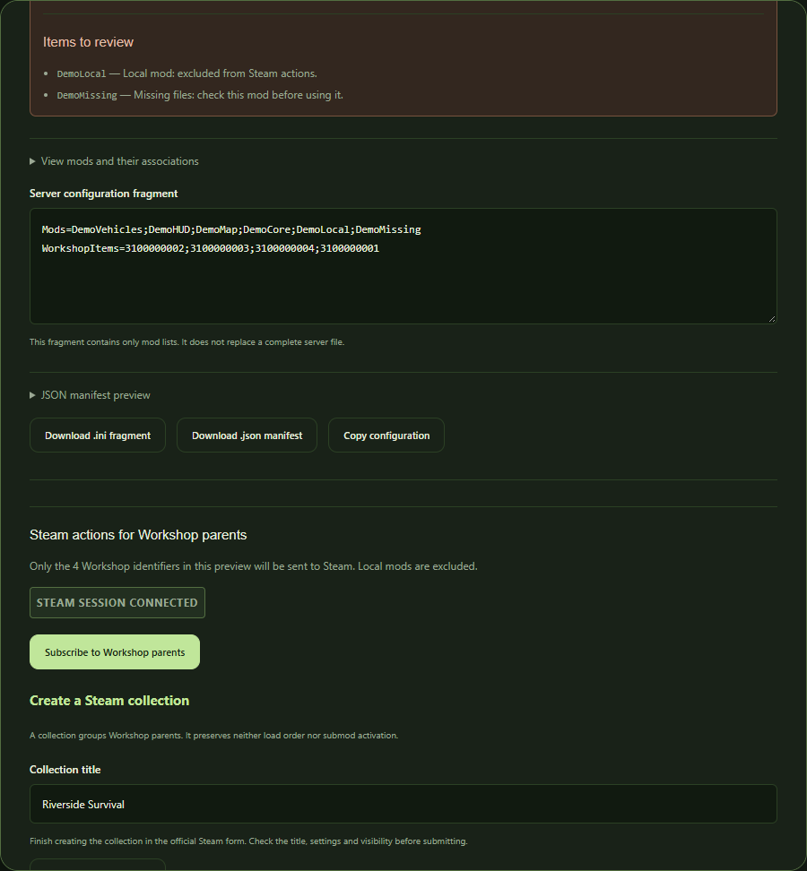

## 14. Share or save a native game profile

Inside the export dialog, enter a **Profile name** and click **Preview profile**. Copy the shareable text, download a standalone `.cfg`, or save directly to `Lua/pz_modlist_settings.cfg` under your configured Zomboid user directory. Local mods and qualified IDs are retained.

Direct saving requires the game to be closed, checks the profile-file revision and creates a backup before replacing an existing file. Replacing an existing profile requires a separate confirmation. Other profiles and favorites are preserved. No Steam account is needed.

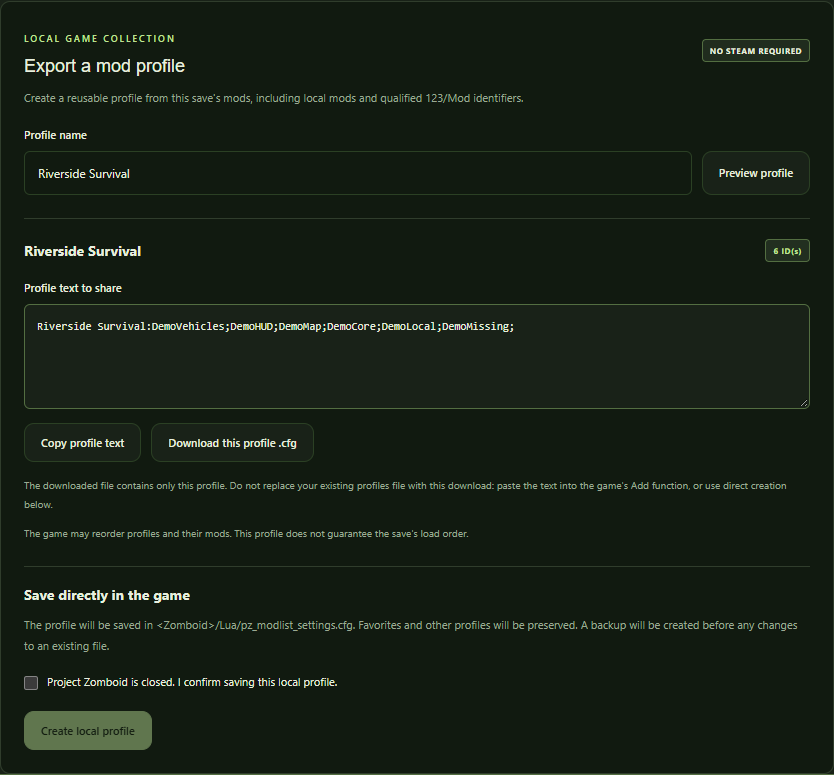

## 15. Analyze a friend's server mod list

Choose **Import a server**, paste `Mods=` and `WorkshopItems=` or open a server `.ini`, then click **Analyze content**. Only those two directives are retained; passwords and unrelated server settings are ignored.

Review recognized IDs, associations and warnings before exporting a new fragment or proceeding to Steam actions. Analysis does not edit a save, server or subscription. A local mod cannot become a Workshop subscription.

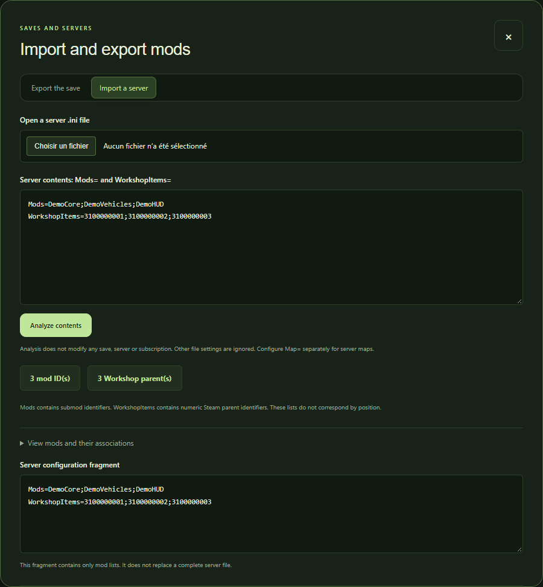

## 16. Prepare Steam subscriptions and a Workshop collection

The transfer dialog offers Steam actions on the resolved Workshop parents. With Microsoft Edge or Google Chrome installed, **Open Steam sign-in** uses a dedicated local browser profile. After connecting, review and confirm subscriptions; already subscribed items are kept and failures are reported by batch.

For a Steam collection, enter a title, open the prefilled official form and finish creating it manually in Steam. Return to detect the collection, then confirm adding the selected parents. PZ Mods does not publish the collection automatically. A Steam collection stores parents, not submod activation or load order: also keep a manifest or server fragment.

In a submod's details, **Parent subscription** opens the parent's Steam page. Manage any unsubscription there: it affects the whole Workshop parent and can affect other saves. Steam may retain files temporarily; unsubscribing does not clean IDs from your sources.

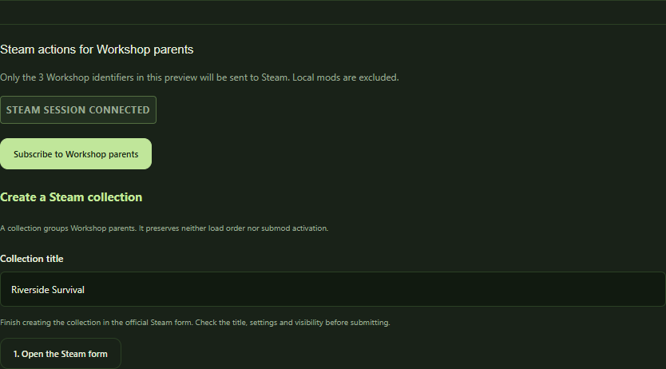

## 17. Choose your language, theme and navigation layout

Under **Settings → Appearance**, switch between English and French without reloading. Choose **Survivor**, **Midnight**, **Amethyst** or **Copper**. The browser remembers these choices, along with the collapsible sidebar and library preferences.

Menus and tooltips support keyboard navigation, Escape dismissal and reduced-motion preferences. Mod authors' names, IDs and descriptions remain in their original language.

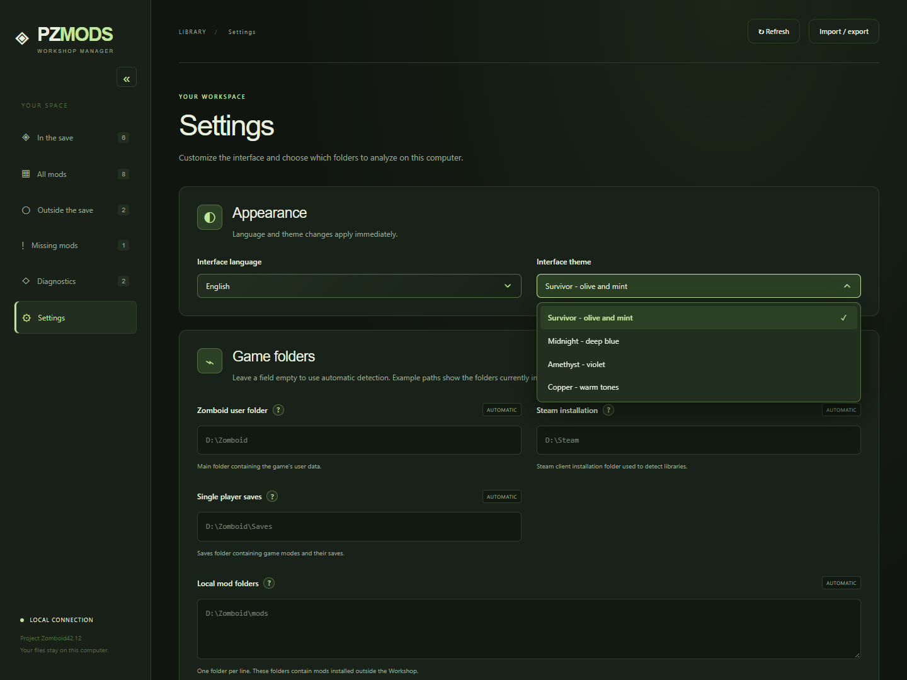

## 18. Point the app at your game folders

Under **Settings → Game folders**, set the Zomboid user root, Steam installation, saves, local mod folders and Workshop directories. Leave a field empty for automatic detection, or restore all automatic paths. Save to reload the library without moving game files or restarting.

Only existing absolute directories are accepted. Folder settings belong to the local backend; language, theme and navigation preferences belong to the browser. The examples below are fictional paths.

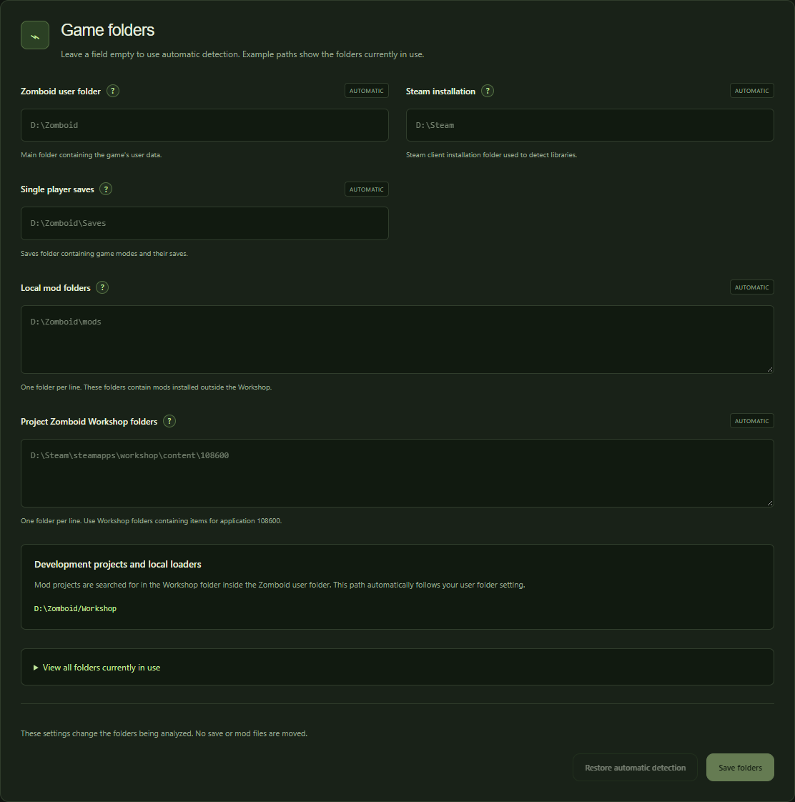

## Configuration and caches

Under **Settings → Game folders**, configure the Zomboid user directory, Steam installation, saves, local mod directories and Workshop `steamapps/workshop/content/108600` directories. Only existing absolute directories are accepted. Empty fields restore automatic detection. Applying paths reloads inventory without moving game files or restarting.

Defaults use `%USERPROFILE%\Zomboid` and Steam's `libraryfolders.vdf`. Development projects under `<userDir>/Workshop/<project>/Contents/mods` are also scanned. Paths persist in Git-ignored `.cache/settings.json`; appearance and navigation remain browser-local. Invalid configured paths fall back to automatic detection at startup.

Optional environment defaults:

```powershell
$env:PZ_USER_DIR = Join-Path $env:USERPROFILE 'Zomboid'
$env:STEAM_PATH = 'D:\Steam'
$env:PORT = '4273'
npm start
```

No `.env` file is required or automatically loaded. If changing the backend port during development, update the Vite proxy too.

Workshop metadata is cached in `.cache/workshop.json` for six hours, posters in `.cache/posters/` for seven days, and local inventory in memory for 30 seconds. **Refresh** forces a local inventory rescan. Previously cached Steam data remains available when Steam is unavailable. Stop the backend before clearing metadata/poster caches. Deleting `.cache/steam-profile/` signs out the dedicated browser.

## Development

Run `npm ci`, then use two terminals:

| Command                | Purpose                                    | Address               |
| ---------------------- | ------------------------------------------ | --------------------- |
| `npm run dev:backend`  | Fastify with source watching               | http://127.0.0.1:4273 |
| `npm run dev:frontend` | React/Vite development server              | http://127.0.0.1:5173 |
| `npm run check`        | UTF-8 checks, lint, types, tests and build | —                     |
| `npm run format:check` | Check Prettier formatting                  | —                     |
| `npm run format`       | Apply Prettier formatting                  | —                     |

Vite proxies `/api` to Fastify. Tests use temporary files and simulated Steam responses, never personal saves or live account mutations.

```text
src/domain/        Models and business rules
src/application/   Use cases and ports
src/adapters/      Filesystem, Steam, caches and HTTP server
web/               React UI; translations in web/locales/
test/              Domain, application, adapter and UI-logic tests
```

The approved lightweight hexagonal architecture is documented in [`AGENTS.md`](AGENTS.md). Dependencies point toward the domain; domain rules perform no disk or network access. Use strict TypeScript, ESLint, Prettier and UTF-8 text.

## Privacy

The server binds to the loopback interface and checks mutation origins. Saves, caches, dependencies and environment files are excluded from Git. Never share `.cache/steam-profile/` or credentials. The backend retrieves Steam metadata and posters; the browser may load Google Fonts. Local paths can appear in the interface and screenshots: review captures before sharing.

Independent community project, unaffiliated with The Indie Stone or Valve.
