<div align="center">

# PZ Mods

**v1.0.0** · [Changelog](CHANGELOG.md) · [English](README.md)

**Votre arsenal, sous contrôle.**

Un gestionnaire local pour les joueurs de Project Zomboid : comprendre les mods d’une sauvegarde, préparer une collection et vérifier les changements avant de les enregistrer.

</div>

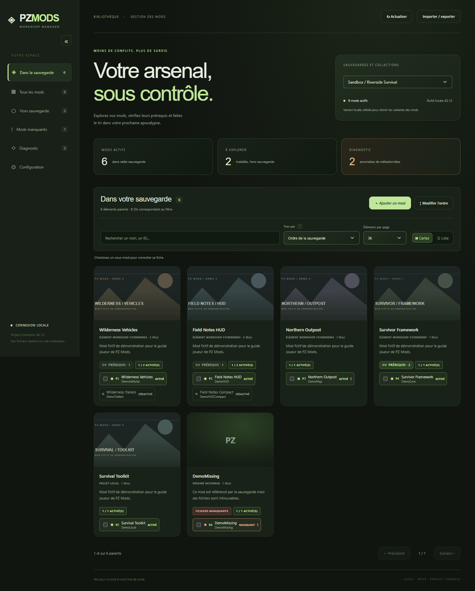

Toutes les captures montrent l’application réelle en français, avec des mods, sauvegardes et collections fictifs. Les posters et les réponses du compte Steam sont des données de démonstration ; aucune action sur un compte réel n’a été effectuée. Les noms et descriptions fournis par les auteurs de mods ne sont pas traduits par l’application.

[Démarrer](#démarrer-avec-une-liste-de-mods-organisée) · [Bibliothèque](#2-explorer-les-parents-workshop-et-leurs-sous-mods) · [Diagnostic](#4-comprendre-le-diagnostic-avant-de-modifier-sa-partie) · [Tri automatique](#9-trier-automatiquement-selon-les-prérequis-et-contraintes) · [Collections](#11-entretenir-une-collection-locale-réutilisable) · [Transferts](#13-exporter-une-liste-serveur-ou-un-manifeste) · [Configuration](#17-choisir-la-langue-le-thème-et-la-navigation)

## Démarrer avec une liste de mods organisée

Prérequis : **Windows**, **Project Zomboid installé via Steam** et **Node.js 24 ou plus récent**, avec npm. Utiliser une sauvegarde solo contenant `mods.txt` ou une collection locale enregistrée dans `Lua/pz_modlist_settings.cfg`. Aucune clé API Steam n’est nécessaire.

```powershell
git clone https://github.com/cyberbobjr/pz-mods.git
cd pz-mods
npm ci
npm run build
npm start
```

Ouvrir **http://localhost:4273** ou **http://127.0.0.1:4273**. Garder le terminal ouvert ; Ctrl+C arrête le serveur. Sous Windows, double-cliquer sur [`lancer.bat`](lancer.bat) pour installer les dépendances si nécessaire, compiler l’interface et ouvrir le navigateur.

Choisir une sauvegarde ou une collection, consulter le **Diagnostic**, puis vérifier les ajouts, retraits et changements d’ordre. Fermer Project Zomboid avant tout enregistrement.

## 1. Choisir une sauvegarde ou une collection locale

Le menu **Sauvegardes et collections** distingue les sauvegardes solo des collections natives du jeu. Sélectionner une source affiche ses IDs actifs, fichiers manquants et diagnostics. La version locale du jeu sert à choisir les variantes installées ; elle ne prouve pas la version historique de la sauvegarde.

Les collections proviennent de `<racine utilisateur>/Lua/pz_modlist_settings.cfg`. Les favoris sont exclus. Modifier une collection ne modifie aucune sauvegarde. Le jeu peut recalculer l’ordre lors de son activation.

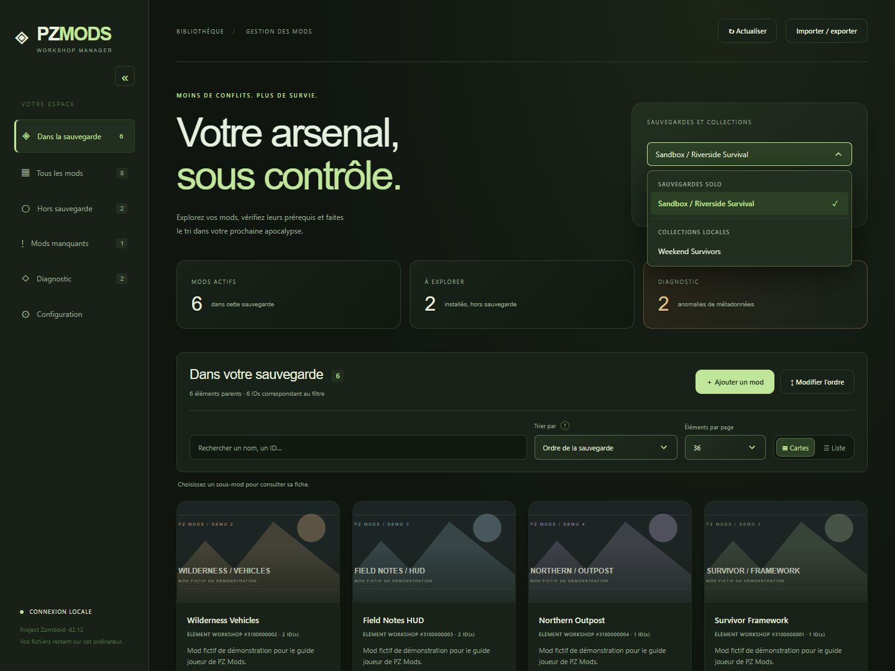

## 2. Explorer les parents Workshop et leurs sous-mods

**Tous les mods** présente le contenu installé, **Dans la sauvegarde** les références actives et **Hors sauvegarde** les mods installés mais inactifs. Les éléments Steam Workshop et les projets de développement locaux partagent la même bibliothèque.

Un parent Workshop représente un élément Steam pouvant contenir plusieurs sous-mods Zomboid. Chaque tag affiche son propre ID, son état activé/désactivé et sa position enregistrée. Cliquer sur le titre, le poster ou un tag ouvre la fiche. Retirer une référence et se désabonner de son parent Workshop n’ont pas la même portée.


## 3. Retrouver un mod et adapter l’affichage

Basculer entre **Cartes** et **Liste**, rechercher par nom ou ID et effacer la recherche en un clic. Choisir 12, 24, 36, 60 ou 100 parents par page : les sous-mods d’un parent restent regroupés.

**Trier par** propose le nom A–Z/Z–A, les mises à jour récentes/anciennes et l’ordre enregistré dans la vue active. Le tri porte sur tous les résultats filtrés avant pagination. Les dates viennent de Steam ou de la modification des métadonnées locales ; les dates inconnues restent à la fin. Trier l’affichage ne réécrit jamais l’ordre enregistré.

Le navigateur mémorise la source, la page, la recherche et les filtres, ainsi que l’affichage, le tri et la taille des pages. Chaque sauvegarde ou collection retrouve son propre contexte de navigation.

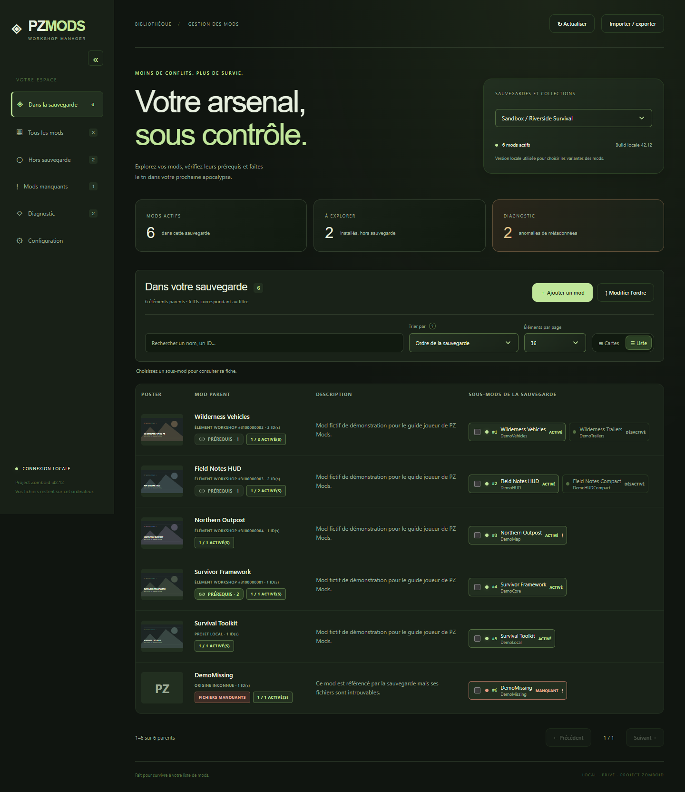

## 4. Comprendre le diagnostic avant de modifier sa partie

Ouvrir **Diagnostic** pour examiner les fichiers manquants, prérequis absents ou inactifs, incompatibilités déclarées, doublons d’IDs et problèmes de plages de versions. Cliquer sur une anomalie ouvre le mod concerné. **Actualiser** relit les fichiers locaux après une installation ou un retrait par Steam.

L’analyse utilise les métadonnées disponibles. Elle ne détecte pas tous les conflits Lua, cartes ou contenus et l’absence d’alerte ne garantit pas l’absence de conflits en jeu. Une copie de `mods.txt` ne remplace pas une sauvegarde complète de la partie avant de changer des mods de cartes, véhicules ou objets.

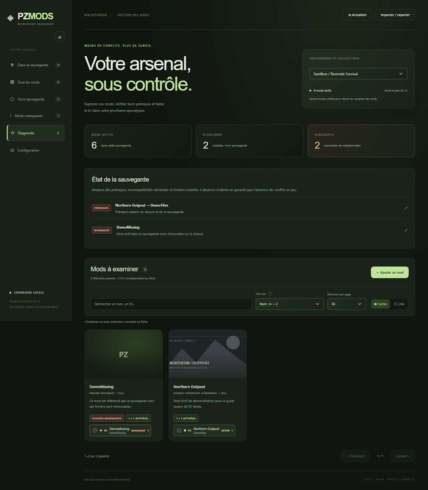

## 5. Consulter les prérequis et ouvrir les fichiers d’un mod

Ouvrir un sous-mod puis **Prérequis et compatibilité** pour consulter ses dépendances, incompatibilités déclarées, informations de version et état actif. La fiche présente aussi les descriptions et les dates Steam ou des métadonnées locales.

**Ouvrir le dossier du mod** ouvre sa racine détectée dans l’Explorateur Windows, pour les mods Workshop comme pour les projets locaux. L’action est indisponible si les fichiers manquent ; actualiser la bibliothèque si le dossier a disparu depuis l’analyse.

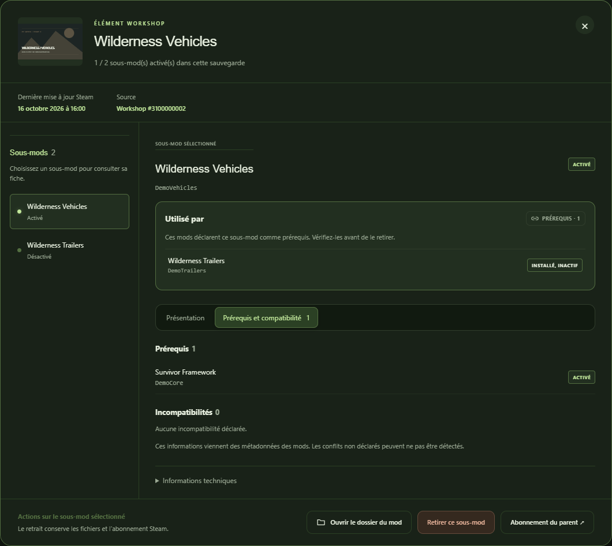

## 6. Identifier les mods qui utilisent un prérequis

Le badge **PRÉREQUIS** d’un parent indique combien de mods déclarent l’un de ses sous-mods comme dépendance. Cliquer dessus ouvre le sous-mod concerné. **Utilisé par** présente les consommateurs directs et distingue les actifs des installés mais inactifs. Cliquer sur un consommateur ouvre sa fiche.

Cette liste aide à décider d’un retrait : les prérequis installés utilisés par les mods actifs restants sont protégés. Les dépendances non déclarées ne peuvent pas être déduites.

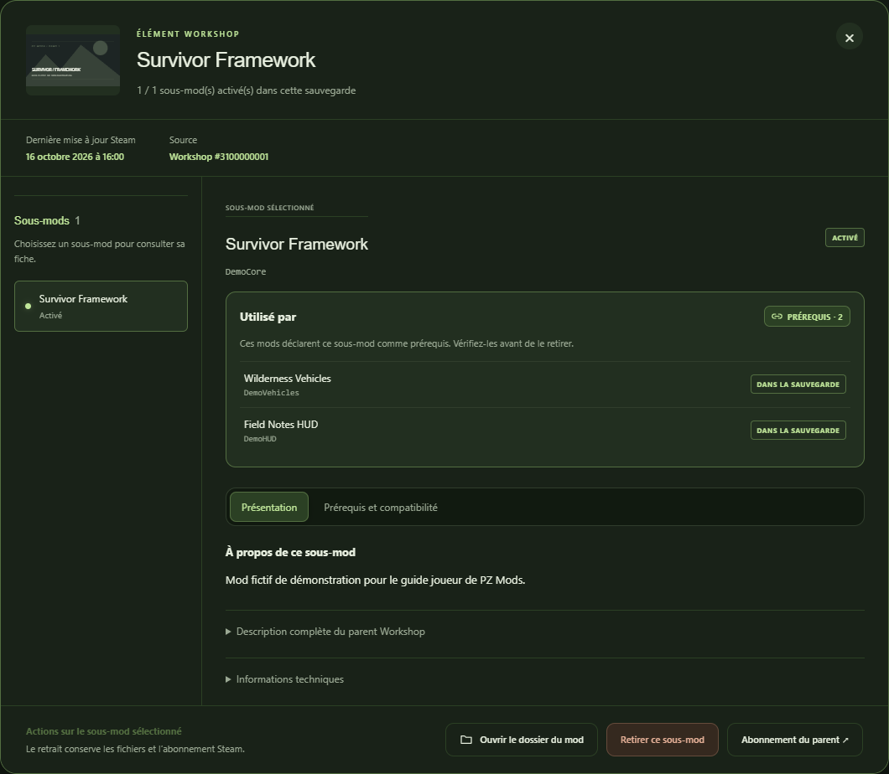

## 7. Ajouter un modId à la source sélectionnée

Cliquer sur **Ajouter un mod**, saisir l’ID de `mod.info` plutôt que le nom affiché ou l’URL Steam, puis **Vérifier**. Un ID qualifié comme `3100000002/DemoTrailers` désigne un fournisseur Workshop précis. Examiner l’ID résolu, la position d’ajout et les alertes, confirmer que le jeu est fermé, puis ajouter.

L’ID est ajouté en fin de liste. Les prérequis ne sont pas activés automatiquement, aucun fichier n’est téléchargé et aucun abonnement Steam n’est créé. Une référence déjà active n’est pas dupliquée. Un ID inconnu peut être ajouté après avertissement, mais ses fichiers devront être installés pour jouer.

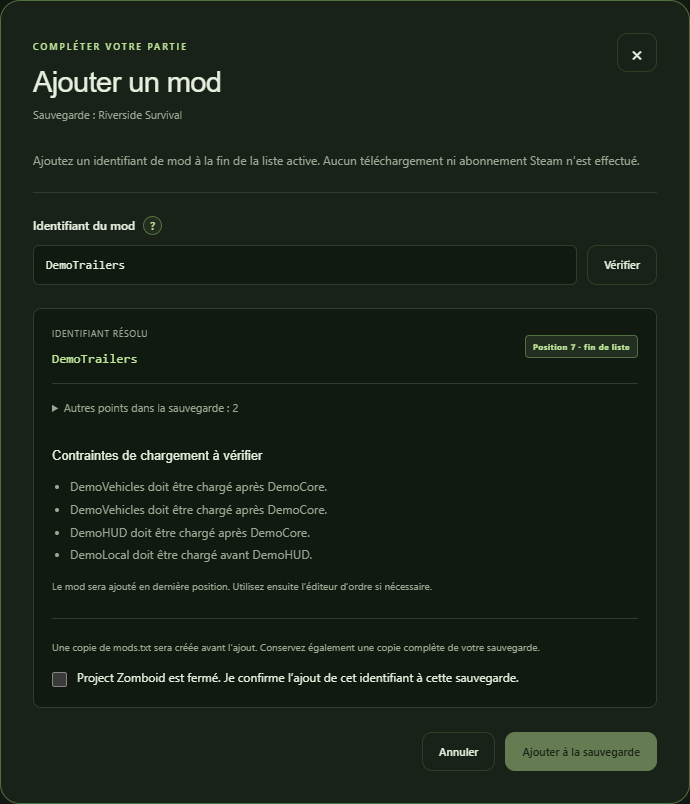

## 8. Modifier manuellement l’ordre des sous-mods

Depuis la vue active, ouvrir **Modifier l’ordre**. Glisser une ligne, utiliser ses boutons ↑/↓ ou saisir une position. Les sous-mods restent indépendants de leur parent Workshop. La recherche masque des lignes sans changer leurs positions dans la liste complète.

**Annuler**, **Rétablir** et **Ordre initial** permettent de reprendre le brouillon. Le rouge signale une nouvelle contrainte enfreinte, l’orange un problème existant et le bleu un mod servant de repère. Les nouvelles violations déclarées bloquent l’enregistrement ; les problèmes existants permettent une correction progressive.

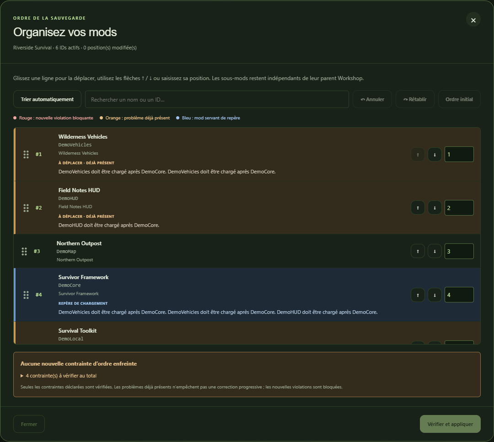

## 9. Trier automatiquement selon les prérequis et contraintes

Cliquer sur **Trier automatiquement** dans l’éditeur. Le tri utilise `require`, `loadAfter` et `loadBefore` pour tous les IDs actifs, y compris les lignes masquées par une recherche. Les prérequis précèdent leurs consommateurs ; les positions du brouillon départagent les choix disponibles.

Le résultat reste un brouillon annulable. Aucun mod n’est ajouté, retiré, téléchargé ou désabonné ; les IDs exacts et qualifications Workshop sont conservés. En cas de cycle, le brouillon reste intact et les IDs bloqués, dont les consommateurs du cycle, sont affichés. Les prérequis absents restent signalés au diagnostic. Les contraintes non déclarées ne sont pas déduites.

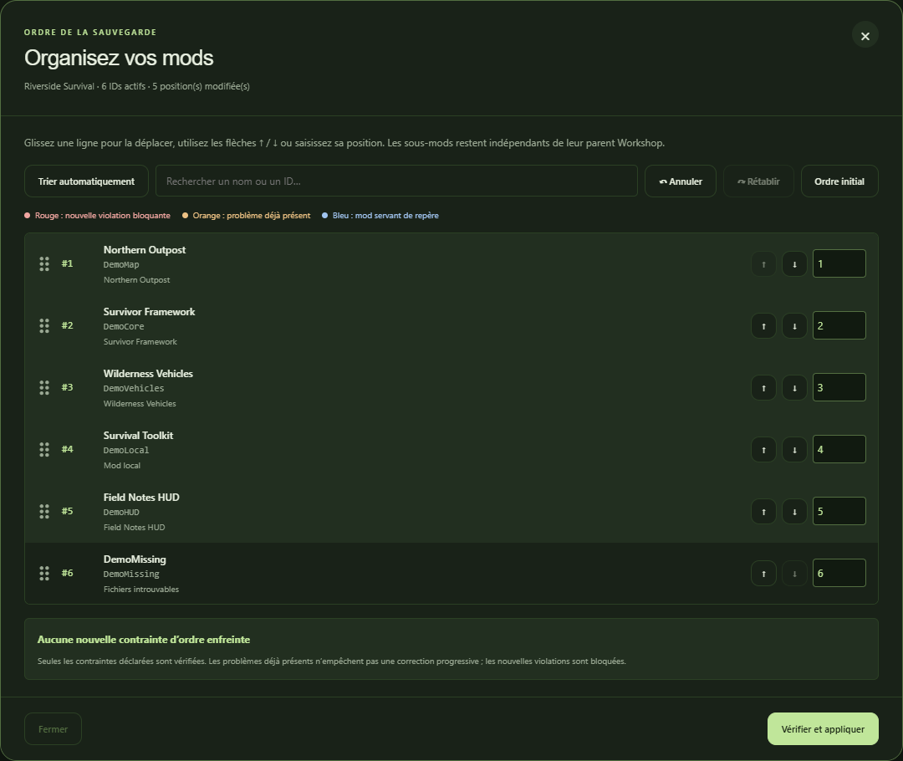

## 10. Vérifier puis enregistrer l’ordre avec une copie de secours

Cliquer sur **Vérifier et appliquer** pour examiner les positions modifiées avant **Confirmer et enregistrer**. Fermer d’abord Project Zomboid. L’application vérifie que la source n’a pas changé, valide l’ordre proposé et copie le fichier existant avant écriture.

Pour une collection, seul le profil sélectionné change : les autres profils et favoris sont conservés. Les nouvelles copies sont rangées dans `<racine utilisateur>/backups/pz-mods/profiles/`. L’interface affiche la progression, l’heure du succès ou une erreur. L’ordre enregistré d’une collection ne garantit pas l’ordre effectif en jeu.

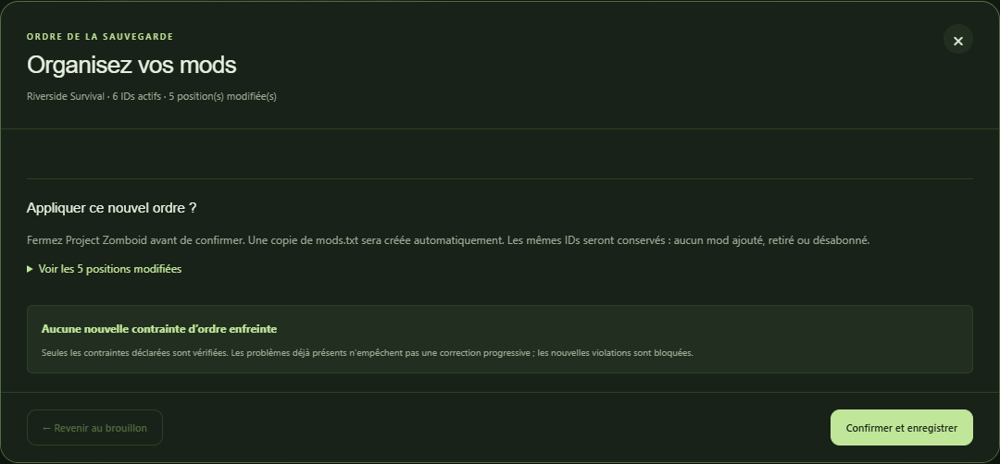

## 11. Entretenir une collection locale réutilisable

Sélectionner une collection pour retrouver les mêmes outils de bibliothèque, diagnostic, ajout, retrait et ordre que pour une sauvegarde. Les écritures ciblent le profil natif et préservent les autres profils, favoris, lignes inconnues, encodage et fins de ligne.

Les contrôles du nom permettent de préparer plusieurs configurations pour des parties différentes. Une collection n’a pas de version de sauvegarde associée : les diagnostics dépendant d’une version ont donc des limites.

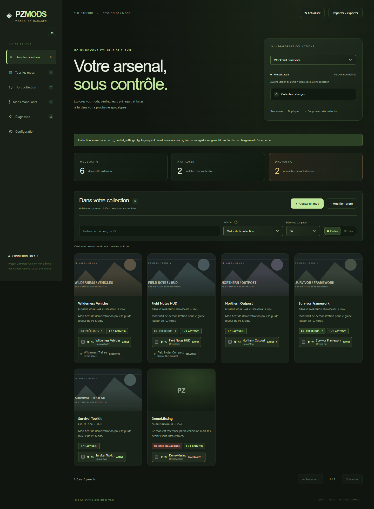

### Dupliquer une collection

Cliquer sur **Dupliquer…**, choisir un nom inutilisé et confirmer que le jeu est fermé. La copie conserve les références exactes et copie les préférences de navigation. La collection d’origine reste disponible.

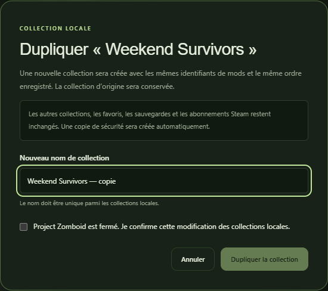

### Renommer une collection

Cliquer sur **Renommer…** et saisir un nom inutilisé. La collection conserve ses références et ses préférences de navigation suivent le nouveau nom. Un nom existant est refusé au lieu d’être écrasé.

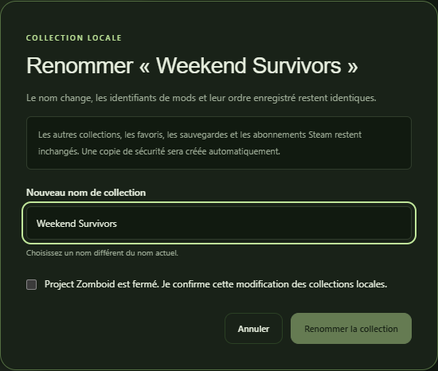

### Supprimer une collection

**Supprimer cette collection…** exige une confirmation explicite et le jeu fermé. Seul le profil sélectionné est retiré, avec une copie de secours ; les autres collections et les favoris restent intacts. Aucun fichier de mod ni abonnement Steam n’est supprimé.

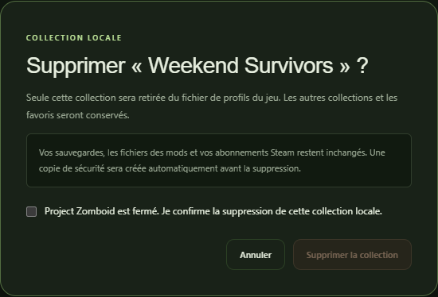

## 12. Nettoyer les références manquantes ou retirer des sous-mods

Dans **Mods manquants**, cliquer sur **Sélectionner les mods manquants** pour sélectionner tous les résultats avant pagination. Examiner la sélection, retirer les IDs et confirmer. Pour les mods installés actifs, cocher les sous-mods souhaités pour ne retirer que leurs références.

Retirer un ID conserve les fichiers et abonnements Steam. Les références qualifiées `123/MonMod` et `456/MonMod` restent distinctes. Retirer une référence absente ne masque pas un prérequis non résolu ; les prérequis installés nécessaires aux mods restants sont protégés. Si un gestionnaire en jeu réintroduit des références, corriger ce gestionnaire séparément.

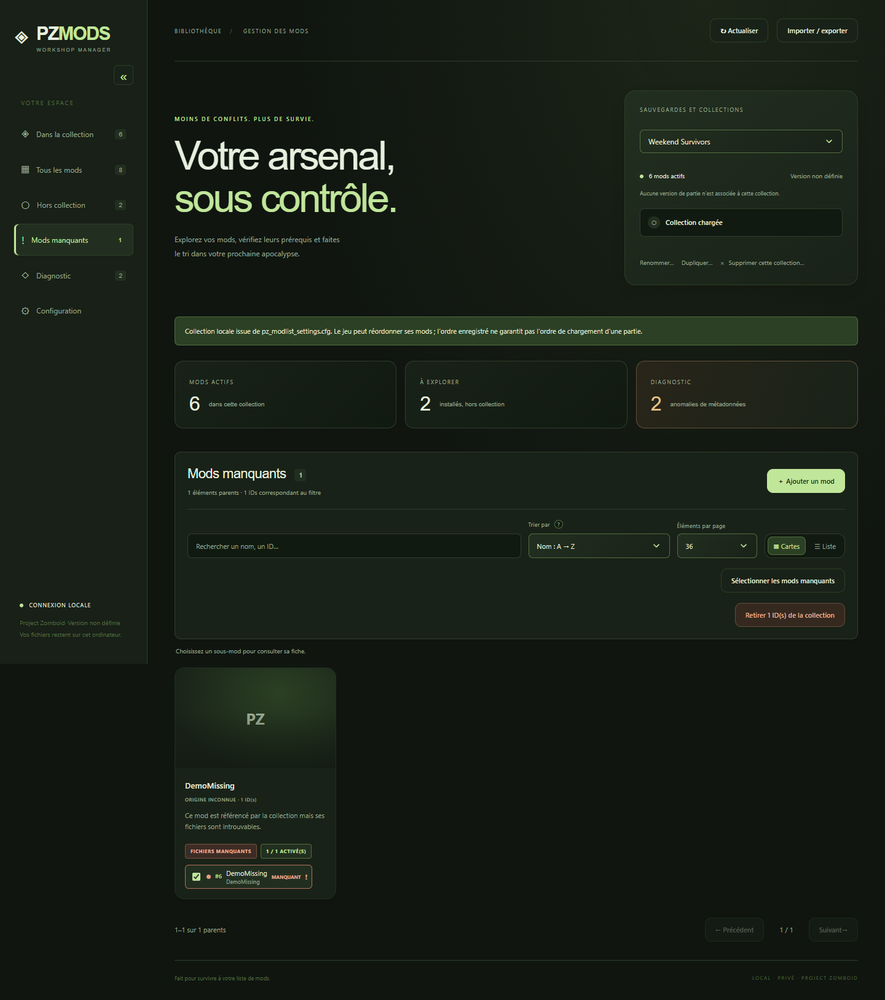

La confirmation rappelle la source ciblée et la portée du retrait. Les contrôles de révision, le jeu fermé et les copies de secours s’appliquent aussi aux retraits.

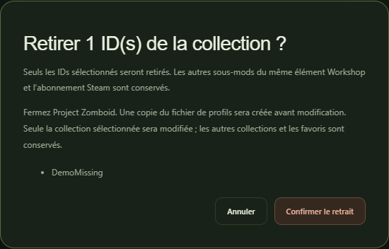

## 13. Exporter une liste serveur ou un manifeste

Ouvrir **Importer / exporter** depuis une sauvegarde ou collection. Examiner le fragment serveur, les associations sous-mods/Workshop et les alertes, puis copier la configuration ou télécharger les fichiers `.ini` et `.json`.

`Mods=` conserve la séquence des IDs Zomboid ; `WorkshopItems=` liste les parents Steam sans doublons. Les listes ne se correspondent pas par position. Les mods locaux, manquants ou ambigus sont signalés. Ce fragment ne remplace pas une configuration serveur complète : régler séparément `Map=`, les paramètres du monde et les fichiers locaux nécessaires.

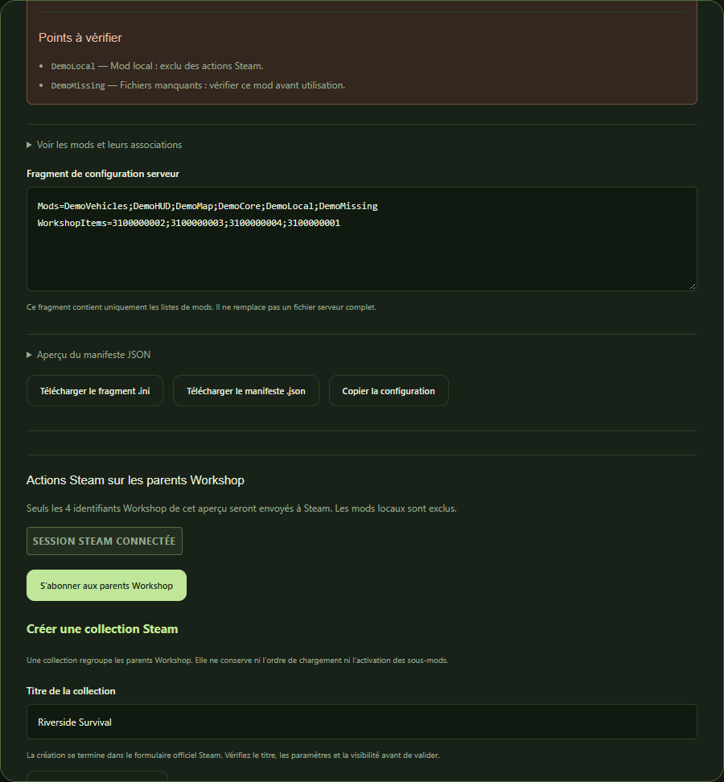

## 14. Partager ou enregistrer un profil natif du jeu

Dans l’export, saisir un **Nom du profil** puis **Prévisualiser le profil**. Copier le texte partageable, télécharger un `.cfg` autonome ou enregistrer dans `Lua/pz_modlist_settings.cfg` sous la racine utilisateur Zomboid configurée. Les mods locaux et IDs qualifiés sont conservés.

L’enregistrement direct exige le jeu fermé, contrôle la révision du fichier et crée une copie avant modification d’un fichier existant. Remplacer un profil existant exige une confirmation supplémentaire. Les autres profils et favoris sont préservés. Aucun compte Steam n’est nécessaire.

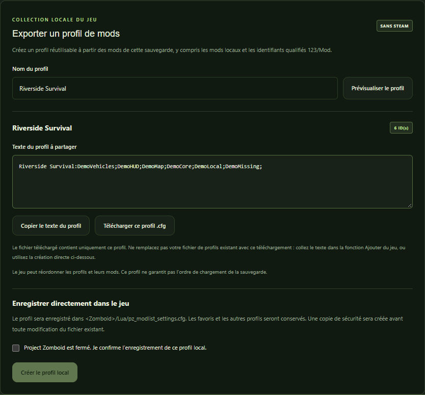

## 15. Analyser la liste de mods d’un serveur ami

Choisir **Importer un serveur**, coller `Mods=` et `WorkshopItems=` ou ouvrir un `.ini`, puis **Analyser le contenu**. Seules ces deux directives sont retenues ; mots de passe et autres paramètres sont ignorés.

Examiner les IDs reconnus, associations et alertes avant d’exporter un nouveau fragment ou de passer aux actions Steam. L’analyse ne modifie aucune sauvegarde, serveur ou abonnement. Un mod local ne peut pas devenir un abonnement Workshop.

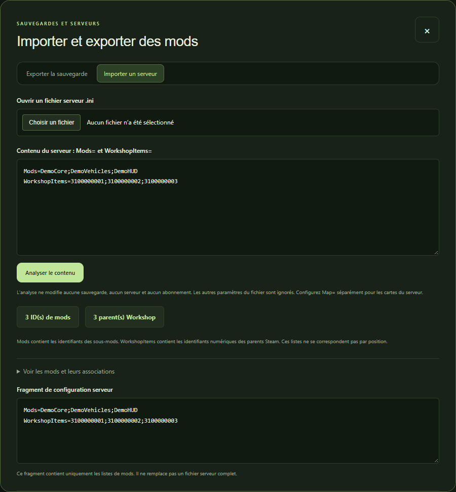

## 16. Préparer les abonnements et une collection Steam

Le transfert propose des actions sur les parents Workshop résolus. Avec Microsoft Edge ou Google Chrome installé, **Ouvrir la connexion Steam** utilise un profil de navigateur local dédié. Après connexion, examiner puis confirmer les abonnements ; les éléments déjà abonnés sont conservés et les échecs détaillés par lot.

Pour une collection Steam, saisir un titre, ouvrir le formulaire officiel prérempli et terminer sa création manuellement sur Steam. Revenir détecter la collection puis confirmer l’ajout des parents. PZ Mods ne publie pas la collection automatiquement. Une collection Steam conserve les parents, pas l’activation des sous-mods ni leur ordre : garder aussi un manifeste ou fragment serveur.

Dans la fiche d’un sous-mod, **Abonnement du parent ↗** ouvre la page Steam du parent. Un éventuel désabonnement se gère sur Steam : il concerne le parent entier et peut affecter d’autres parties. Steam peut conserver temporairement les fichiers ; le désabonnement ne nettoie pas les IDs des sources.

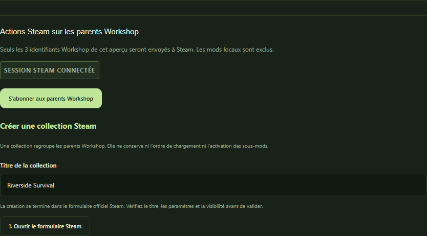

## 17. Choisir la langue, le thème et la navigation

Dans **Configuration → Apparence**, passer du français à l’anglais sans rechargement. Choisir **Survivant**, **Nocturne**, **Améthyste** ou **Cuivre**. Le navigateur conserve ces choix, le repli de la barre latérale et les préférences de bibliothèque.

Les menus et infobulles prennent en charge le clavier, la fermeture avec Échap et la réduction des animations. Les noms, IDs et descriptions des auteurs restent dans leur langue d’origine.

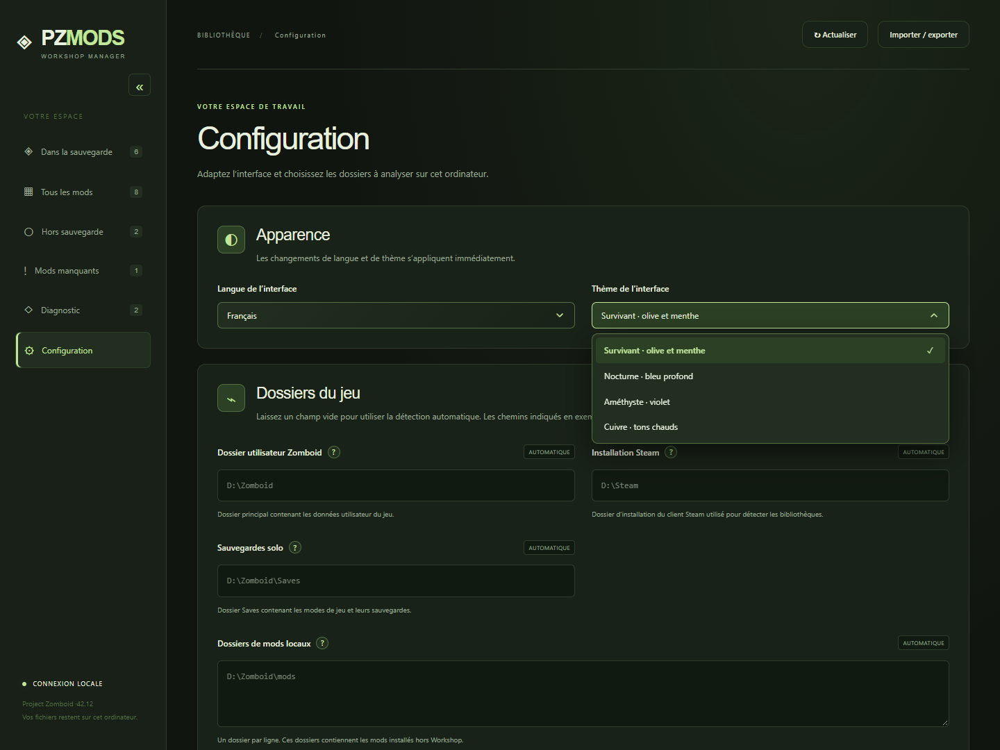

## 18. Choisir les dossiers du jeu à analyser

Dans **Configuration → Dossiers du jeu**, définir la racine utilisateur Zomboid, Steam, les sauvegardes, les mods locaux et le Workshop. Laisser un champ vide utilise la détection automatique ; une commande rétablit tous les chemins automatiques. Enregistrer recharge la bibliothèque sans déplacer de fichier ni redémarrer.

Seuls les dossiers absolus existants sont acceptés. Les chemins sont propres au backend local ; langue, thème et navigation restent dans le navigateur. Les chemins illustrés sont fictifs.

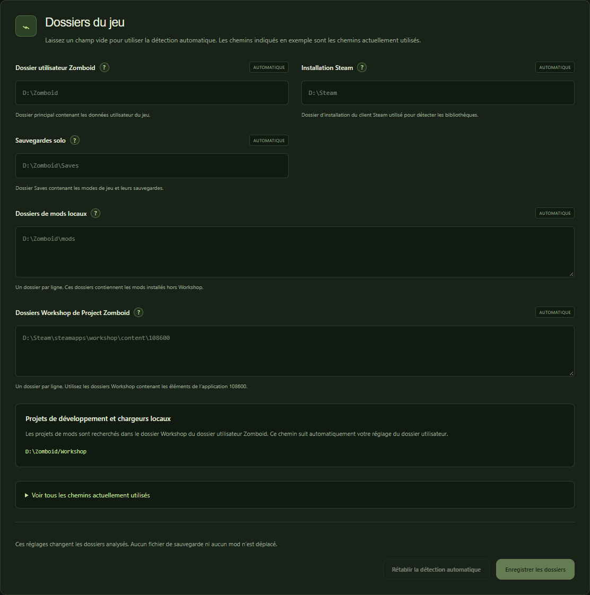

## Configuration

Les emplacements par défaut sont `%USERPROFILE%\Zomboid` et les bibliothèques déclarées dans le `libraryfolders.vdf` de Steam.

La page **Configuration → Dossiers du jeu** permet de personnaliser :

| Réglage                    | Dossier attendu                                                                           |
| -------------------------- | ----------------------------------------------------------------------------------------- |
| Racine utilisateur Zomboid | Dossier principal des données utilisateur du jeu.                                         |
| Installation Steam         | Racine du client Steam, contenant `steamapps/libraryfolders.vdf`.                         |
| Sauvegardes solo           | Dossier `Saves`, contenant les modes puis leurs sauvegardes.                              |
| Mods locaux                | Un ou plusieurs dossiers contenant les répertoires des mods, un chemin par ligne.         |
| Workshop Project Zomboid   | Un ou plusieurs dossiers `steamapps/workshop/content/108600`, contenant les IDs Workshop. |

Les projets en développement sont toujours analysés dans `<racine Zomboid>/Workshop/<projet>/Contents/mods`. Les dossiers effectivement utilisés sont consultables sur cette page. Laisser un champ vide rétablit la détection automatique pour ce réglage ; **Restaurer la détection automatique** rétablit tous les chemins par défaut.

Cliquer sur **Enregistrer les dossiers** pour appliquer les chemins : seuls des dossiers absolus existants sont acceptés, l’inventaire est rechargé sans redémarrage et aucun fichier de jeu n’est déplacé. Les réglages sont enregistrés dans `.cache/settings.json`, exclu de Git, et repris au prochain lancement. Ils sont communs aux navigateurs utilisant ce backend. Les préférences d’apparence et de navigation restent propres au navigateur.

Les variables d’environnement restent disponibles comme valeurs par défaut, lorsqu’aucun chemin n’est configuré dans l’interface :

```powershell
$env:PZ_USER_DIR = Join-Path $env:USERPROFILE 'Zomboid'
$env:STEAM_PATH = 'D:\Steam'
$env:PORT = '4273'
npm start
```

Ces variables sont facultatives. Aucun fichier `.env` n’est nécessaire ni chargé automatiquement. En développement, adapter aussi le proxy de `vite.config.ts` si le port du backend change.

Si un dossier configuré n’est plus accessible au démarrage, l’application revient aux chemins automatiques. Vérifier et réenregistrer les réglages après avoir reconnecté un disque externe.

### Cache et actualisation

Les métadonnées Workshop sont conservées dans `.cache/workshop.json` pendant six heures, les posters dans `.cache/posters/` pendant sept jours et l’inventaire local en mémoire pendant trente secondes. **Actualiser** force une nouvelle lecture des fichiers locaux. Les données Steam déjà téléchargées restent utilisables si Steam est indisponible ; les éléments jamais consultés nécessitent une première connexion.

Arrêter le backend avant de vider les caches de métadonnées ou de posters. Le profil `.cache/steam-profile/` est distinct : le supprimer déconnecte le navigateur dédié. Les anciennes copies de secours des profils ne sont ni déplacées ni supprimées automatiquement.

## Développement

Installer d’abord les dépendances avec `npm ci`, puis ouvrir **deux terminaux** dans le projet.

| Terminal              | Commande               | Adresse                 |
| --------------------- | ---------------------- | ----------------------- |
| Backend Fastify       | `npm run dev:backend`  | `http://127.0.0.1:4273` |
| Frontend React / Vite | `npm run dev:frontend` | `http://127.0.0.1:5173` |

Le frontend relaie `/api` vers le backend. Utiliser les adresses indiquées ; les deux services doivent rester ouverts. Le backend et Vite rechargent leurs sources après modification.

### Vérifications

```powershell
npm run check         # UTF-8, ESLint, types, tests et build
npm run format:check  # Mise en forme Prettier
npm run format        # Appliquer Prettier
```

Les tests utilisent des fichiers temporaires et des réponses Steam simulées ; ils n’écrivent pas dans les sauvegardes réelles.

Le frontend utilise des composants Radix comportant la directive React Server Components `"use client"`. L’application étant entièrement rendue dans le navigateur, le build ignore uniquement l’avertissement Rollup `MODULE_LEVEL_DIRECTIVE` correspondant à cette directive dans les paquets `@radix-ui`. Les autres avertissements restent visibles.

### Architecture

```text
src/
├── domain/        Modèles et règles métier indépendants
├── application/   Cas d’usage et ports
└── adapters/      Fichiers Zomboid, Steam, cache et serveur HTTP
web/               Interface React
test/              Tests métier et adaptateurs
```

L’architecture hexagonale et les dépendances autorisées sont documentées dans [`AGENTS.md`](AGENTS.md). Le domaine ne dépend ni du disque, ni de Fastify, ni de Steam.

## Confidentialité

- Le serveur écoute uniquement sur **l’interface locale** et contrôle l’origine des mutations.
- Aucune clé Steam, session Steam ou connexion au compte n’est nécessaire pour consulter les informations publiques.
- Les sauvegardes, caches, dépendances et fichiers d’environnement sont exclus de Git.
- Le profil Steam dédié contient des données de connexion locales : ne jamais partager `.cache/steam-profile/`. Les actions d’abonnement et de collection nécessitent une connexion Steam et une confirmation explicite dans l’application.
- Les métadonnées Steam et posters sont récupérés par le backend ; les polices Google Fonts peuvent être chargées par le navigateur.
- Les chemins de fichiers locaux sont visibles dans votre interface et peuvent apparaître dans vos captures : les vérifier avant de les partager.

Le dépôt contient le code, la documentation et des données de test fictives, sans export de sauvegarde ni inventaire personnel de mods.

Projet communautaire indépendant, sans affiliation avec The Indie Stone ou Valve.
